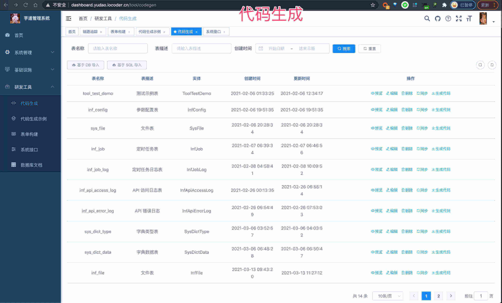
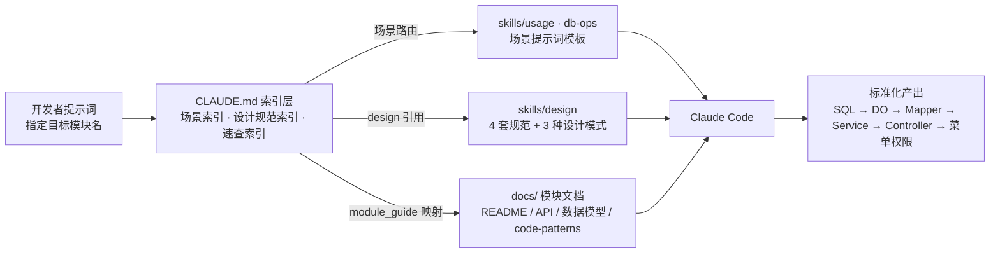
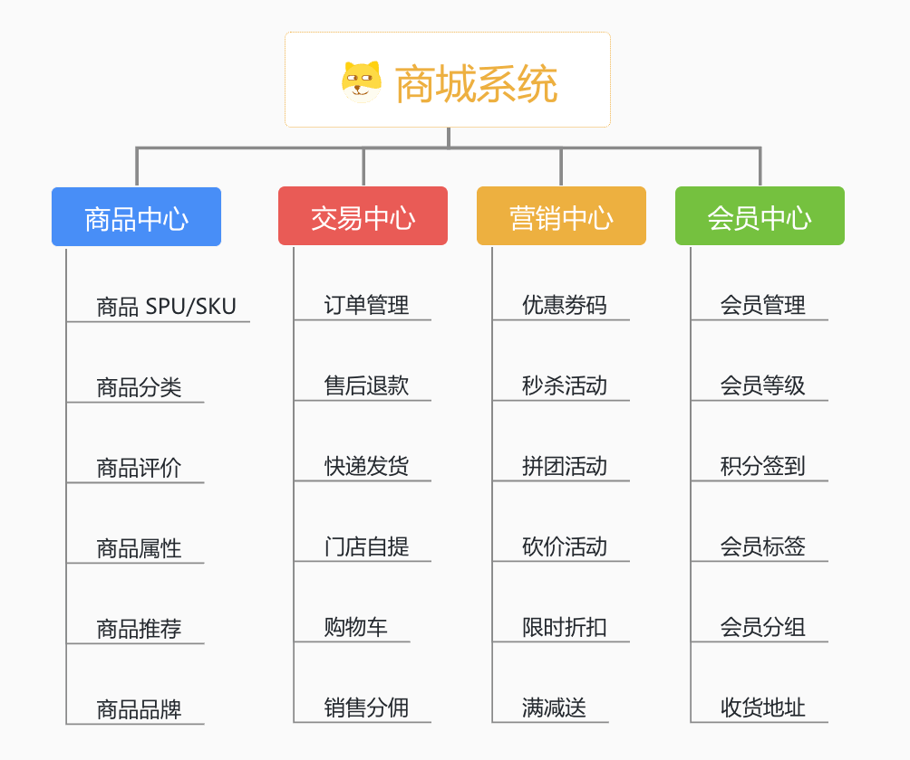
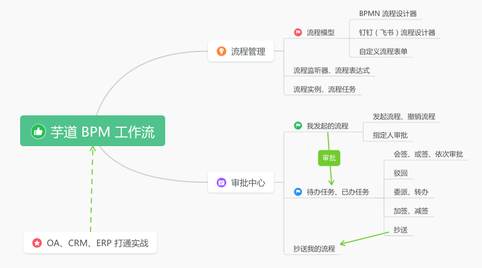
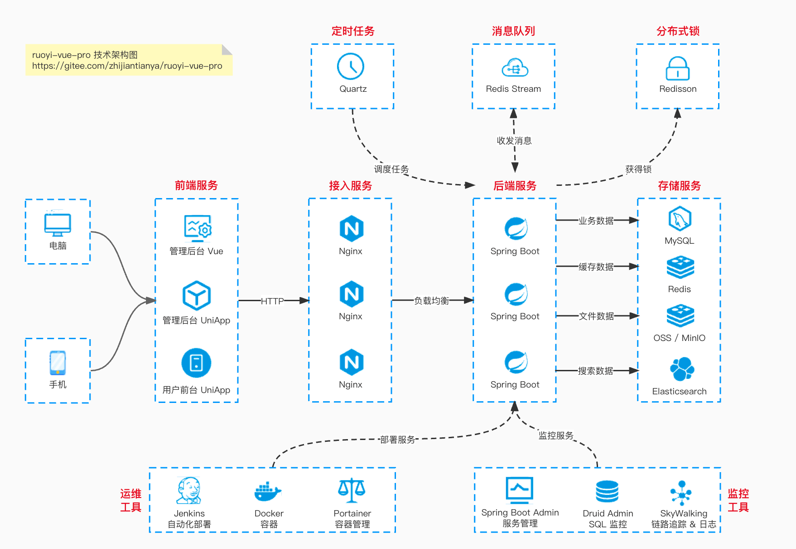

<div align="center">

# yudao-skill-pro

**基于芋道 ruoyi-vue-pro 的 AI 辅助开发知识库，让 Claude Code 生成符合项目规范的标准化代码**

面向使用 Claude Code 等 AI 编程工具的后端开发者

[](LICENSE)
[](https://github.com/YunaiV/ruoyi-vue-pro)
[](https://github.com/YunaiV/ruoyi-vue-pro)
[](https://spring.io/projects/spring-boot)
[](https://adoptium.net/)
[](https://cn.vuejs.org/)
[](https://claude.com/claude-code)

[核心特性](#-核心特性) · [快速开始](#-快速开始) · [工作原理](#-工作原理三层知识体系) · [与上游的区别](#-与上游仓库的区别) · [模块文档](#-模块功能文档) · [使用场景](#-使用场景导航)

</div>

本仓库 = 芋道 [ruoyi-vue-pro](https://github.com/YunaiV/ruoyi-vue-pro) 完整工程（原样保留、定期同步上游）+ 一套三层 Skill 知识体系：`CLAUDE.md` 索引层、`skills/` 规范层、`docs/` 模块文档层。在提示词中指定目标模块名，AI 会自动加载对应的规范与文档，生成符合项目标准的 SQL → DO → Mapper → Service → Controller 代码。

## ✨ 核心特性

> 🆕 = 本仓库相对上游 ruoyi-vue-pro 新增的能力

- **三层 Skill 体系自动加载**：提示词指定目标模块名，AI 自动加载对应规范与模块文档 → [CLAUDE.md](CLAUDE.md)
- **设计规范内建**：数据库 / 实体类 / API / CRUD 4 套规范 + 工厂 / 策略 / 模板方法 3 种设计模式指南，约束每一行生成代码 → [skills/design/db-designer.md](skills/design/db-designer.md)、[skills/design/patterns/index.md](skills/design/patterns/index.md)
- **19 个业务模块的功能文档**：API 详情、数据模型、代码模式、踩坑点，按模块裁剪 → [docs/README.md](docs/README.md)
- **场景化提示词模板**：从建表 SQL 到完整 CRUD、配置菜单权限、数据库安全操作，复制即用 → [skills/usage/index.md](skills/usage/index.md)
- 🆕 **数据库安全操作（db-ops）**：解析 yaml 凭证、dry-run 预演、写操作事务保护 → [skills/db-ops/SKILL.md](skills/db-ops/SKILL.md)
- 🆕 **补充模块功能文档**：为 fms / oa / hrm / pms 模块编写功能文档（模块代码随上游同步） → [docs/modules/fms/README.md](docs/modules/fms/README.md)

## 🚀 快速开始

1. 克隆仓库并用 Claude Code 打开根目录，`CLAUDE.md` 自动生效：

   ```bash
   git clone https://github.com/cilangzzz/yudao-skill-pro.git
   ```

2. 复制粘贴提示词，把 `system` 替换为你的目标模块名即可开工：

   ```text
   使用 Skill 文档，帮我在 system 模块添加一个"操作日志"功能。
   参考 docs/modules/system/code-patterns.md
   ```

3. 下一步：完整提示词模板见 [skills/usage/quick-start.md](skills/usage/quick-start.md)，场景总览见 [skills/usage/index.md](skills/usage/index.md)。



> 上游自带代码生成器，需逐表配置；本仓库的 Skill 体系让 AI 直接生成同等规范度的代码。

## 🧭 工作原理：三层知识体系



- 自动引用机制：使用样例文档头部以 YAML front matter 声明需引用的规范，AI 读取时自动加载，详见 [CLAUDE.md「自动引用机制」](CLAUDE.md)。
- 各层完整清单以 `CLAUDE.md` 为权威索引，本 README 不重复维护。

## 🆚 与上游仓库的区别

本仓库基于 [YunaiV/ruoyi-vue-pro](https://github.com/YunaiV/ruoyi-vue-pro) 同步代码，上游工程原样保留，以下为本仓库新增内容：

| 层 | 路径 | 说明 |
|-----|------|------|
| 索引层 | `CLAUDE.md` + `.claude/` | AI 自动加载的规范总索引与 Claude Code 工作流配置 |
| 规范层 | `skills/` | 4 套设计规范、3 种设计模式指南、场景化提示词模板、db-ops 数据库安全操作规范 |
| 文档层 | `docs/` | 19 个业务模块的功能文档：模块总览、API 详情、数据模型、代码模式、踩坑点（按模块裁剪） |
| 🆕 文档增量 | `docs/modules/{fms,oa,hrm,pms}` | 为上游 fms / oa / hrm / pms 模块编写的功能文档 |

> 同步方式：定期从 upstream/master 拉取最新代码合并，以上自定义内容始终保留。

## 🗂 模块功能文档

各模块文档的完整索引（含依赖关系与数据模型概览）见 [docs/README.md](docs/README.md)，以下按业务分组概览：

| 分组 | 模块 |
|------|------|
| 平台基座 | system、infra |
| 交易与会员 | mall、pay、member、mp |
| 协同与效率 | bpm、crm、erp、report、im、ai、oa |
| 智造与物联 | mes、wms、iot |
| 人事财务与项目 | fms、hrm、pms |

<details>
<summary>📦 模块功能图速览</summary>

**mall**：商品 SPU/SKU、订单、促销



**erp**：采购、销售、库存、财务


**bpm**：流程模型、流程定义、任务审批



</details>

## 📖 使用场景导航

- **不确定从哪个场景开始** → [skills/usage/index.md](skills/usage/index.md)（场景分类目录 + 使用流程图 + FAQ）
- **从建表 SQL 到完整 CRUD 功能** → [skills/usage/entity-implementation.md](skills/usage/entity-implementation.md)
- **为新功能配置后台菜单与按钮权限** → [skills/usage/menu-permission.md](skills/usage/menu-permission.md)
- 🆕 **解析 yaml 凭证、安全执行 SQL** → [skills/db-ops/SKILL.md](skills/db-ops/SKILL.md)

全部场景的完整清单以 [CLAUDE.md「Skills 使用场景索引」](CLAUDE.md)为准。

## 🧩 底层工程：上游 ruoyi-vue-pro

底层完整继承芋道 ruoyi-vue-pro——基于 Spring Boot 2.7 / MyBatis-Plus 的多模块企业级开发平台，内置 19 个业务模块（工作流、支付、商城、ERP 等）与多套前端（Vue2 / Vue3 / vben / uniapp）。Skill 体系的全部规范与文档均以该工程的真实代码为蓝本，生成的代码可直接融入工程。

- 上游仓库：[YunaiV/ruoyi-vue-pro](https://github.com/YunaiV/ruoyi-vue-pro)
- 官方文档：[doc.iocoder.cn](https://doc.iocoder.cn/)

<details>
<summary>🗺 系统分层架构图</summary>



</details>

## ❓ FAQ

**与上游是什么关系？会跟随更新吗？**

定期从 upstream/master 合并上游代码，本仓库自定义内容（`CLAUDE.md`、`skills/`、`docs/`）始终保留，详见[与上游仓库的区别](#-与上游仓库的区别)。

**需要付费或接入外部服务吗？**

MIT 开源；知识库为纯 Markdown 文档，仅需本机安装 Claude Code，无任何外部服务依赖。

**`CLAUDE.md`、`skills/`、`docs/` 应该读哪个？**

`CLAUDE.md` 是 AI 自动加载的索引层，`skills/` 与 `docs/` 是其指向的内容层。人类读者从 [skills/usage/index.md](skills/usage/index.md) 进入即可，AI 生成由 `CLAUDE.md` 自动接管，无需手动喂文档。

## 📁 附录：skills/ 目录结构

<details>
<summary>展开 skills/ 目录结构</summary>

```
skills/
├── design/
│   ├── db-designer.md
│   ├── entity-designer.md
│   ├── crud-designer.md
│   ├── api-designer.md
│   └── patterns/
│       ├── index.md
│       ├── factory-pattern.md
│       ├── strategy-pattern.md
│       └── template-method-pattern.md
├── usage/
│   ├── index.md
│   ├── entity-implementation.md
│   ├── extend-module.md
│   ├── new-module.md
│   ├── menu-permission.md
│   ├── refactor-module.md
│   ├── pattern-usage.md
│   └── quick-start.md
└── db-ops/
    └── SKILL.md
```

文件清单以仓库实际文件为准，各文件职责与引用关系见 [CLAUDE.md](CLAUDE.md) 索引。

</details>

## 🔗 相关链接

**本仓库入口**

- [CLAUDE.md](CLAUDE.md) — AI 自动加载的规范总索引
- [docs/README.md](docs/README.md) — 模块功能文档总索引
- [skills/usage/index.md](skills/usage/index.md) — 使用指南总览（场景目录 + 流程图 + FAQ）

**上游与官方**

- [YunaiV/ruoyi-vue-pro](https://github.com/YunaiV/ruoyi-vue-pro) — 原始工程
- [芋道官方文档](https://doc.iocoder.cn/) — 上游使用文档
- [Claude Code](https://claude.com/claude-code) — AI 编程工具官方文档

## 📄 开源协议

基于 [MIT License](LICENSE) 开源；LICENSE 文件继承自上游 ruoyi-vue-pro（Copyright (c) 2021）。
