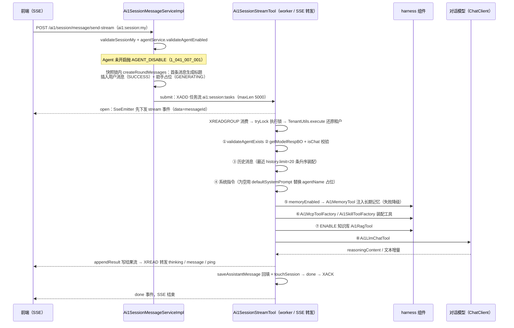
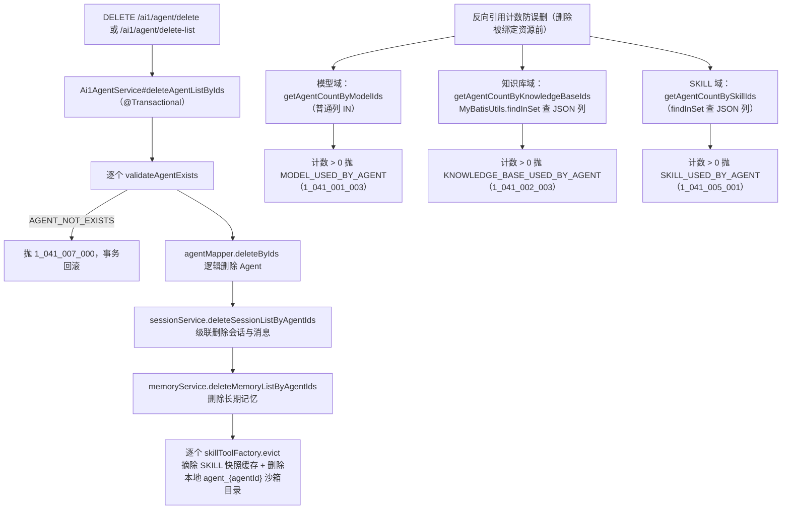

# AI1 Agent 编排接口 (Ai1AgentController)

> Agent 是 ai1 模块（yudao-module-ai1-springai）的编排核心：`Ai1AgentDO`（表 `ai1_agent`）以七个配置项——对话模型（`providerId` + `modelId`，须为 CHAT 类型）、系统指令 `systemPrompt`、知识库 `knowledgeBaseIds`、MCP 工具 `mcpIds`、SKILL 技能 `skillIds`、长期记忆开关 `memoryEnabled`、状态开关 `status`（开启后才可用于会话）——把平台的模型、RAG、工具与记忆能力聚合成一个可执行的智能体。本域管理端接口仅负责 Agent 本身的 CRUD 与状态维护；真正的编排发生在会话链路：harness 层 `Ai1SessionStreamTool#generate` 在每次消息生成时按配置装配上下文与工具，经 Redis Stream 任务队列 + worker + 结果流 + SSE 转发完成生成（详见 [api-session.md](api-session.md)）。

## 接口路径前缀

- `/ai1/agent` (Controller: Ai1AgentController) — Agent 管理

---

## 1. 创建 Agent

- **路径**: POST /ai1/agent/create
- **权限**: ai1:agent:create
- **说明**: 新增一个 Agent（编排配置），初始为关闭状态

**请求参数 (Ai1AgentSaveReqVO)**:

| 字段 | 类型 | 必填 | 校验规则 | 说明 |
|-----|------|-----|---------|------|
| id | Long | 新增不传 | - | 编号 |
| name | String | 是 | @NotEmpty、@Size(max = 100)（javax.validation） | 名称 |
| introduction | String | 否 | @Size(max = 500) | 介绍 |
| providerId | Long | 是 | @NotNull | 模型所属 Provider 编号 |
| modelId | Long | 是 | @NotNull | 对话模型编号，必须为 CHAT 类型 |
| systemPrompt | String | 否 | - | 系统指令；为空时会话生成时用 defaultSystemPrompt 替换 `{agentName}` 占位符 |
| knowledgeBaseIds | List\<Long\> | 否 | - | 知识库编号集合（`LongListTypeHandler` 存 JSON 数组列） |
| mcpIds | List\<Long\> | 否 | - | MCP 编号集合 |
| skillIds | List\<Long\> | 否 | - | SKILL 编号集合 |
| memoryEnabled | Boolean | 否 | - | 是否开启长期记忆；开启后对话时注入记忆，并由 Job 归档已完成消息 |

**响应**: CommonResult\<Long\> — 新 Agent 编号

**业务逻辑**: 1. `validateChatModel(providerId, modelId)`：先经 `Ai1ModelService#getModelRespBO` 校验 Provider、模型存在且开启、归属一致，再经 `Ai1ModelTypeEnum#isChat` 校验为对话模型，否则抛 MODEL_TYPE_NOT_CHAT；2. `BeanUtils.toBean` 转 `Ai1AgentDO` 后 `setStatus(CommonStatusEnum.DISABLE.getStatus())` —— **创建后初始为关闭（1）**，需显式调用「修改 Agent 状态」开启后才能在会话中使用；3. `agentMapper.insert` 插入并返回主键。

**错误码**:

| 错误码 | 说明 |
|-------|------|
| 1_041_001_005 | 所选模型不是对话模型 |
| 1_041_000_000 / 1_041_000_001 | 供应商不存在 / 供应商({}) 已禁用（对话模型校验） |
| 1_041_001_000 / 1_041_001_001 / 1_041_001_004 | 模型不存在 / 模型({}) 已禁用 / 模型不属于该供应商（对话模型校验） |

> 校验注意：`Ai1AgentSaveReqVO` 与本 Controller 的 `@Valid` 使用 javax.validation（本仓库为 JDK8 + Spring Boot 2.7.18，javax 校验生效）；同模块的 `Ai1AgentUpdateStatusReqVO` 误用了 jakarta.validation，其 `@NotNull` 会被 javax 验证器静默跳过。新增/改造 VO 应统一使用 javax，详见 [pitfalls.md](pitfalls.md) 1.1。

## 2. 更新 Agent

- **路径**: PUT /ai1/agent/update
- **权限**: ai1:agent:update
- **说明**: 按编号更新 Agent 的编排配置（状态不在此修改）

**请求参数 (Ai1AgentSaveReqVO)**: 同 1，其中 id 必传

**响应**: CommonResult\<Boolean\> — 固定 true

**业务逻辑**: 1. `validateAgentExists` 校验存在（不存在抛 AGENT_NOT_EXISTS）；2. `validateChatModel` 校验对话模型（同创建）；3. `agentMapper.updateById` 全量更新。`Ai1AgentSaveReqVO` 无 status 字段，**状态只能走 update-status 接口单独修改**；`knowledgeBaseIds` / `mcpIds` / `skillIds` 三个 JSON 数组列经 `LongListTypeHandler` 随 updateById 一并写入。

**错误码**:

| 错误码 | 说明 |
|-------|------|
| 1_041_007_000 | Agent 不存在 |
| 1_041_001_005 及模型/供应商段 | 同 1（对话模型校验） |

## 3. 修改 Agent 状态

- **路径**: PUT /ai1/agent/update-status
- **权限**: ai1:agent:update
- **说明**: 单独修改状态（0 开启 / 1 关闭）；开启后才可在「Agent 会话」中使用

**请求参数 (Ai1AgentUpdateStatusReqVO)**:

| 字段 | 类型 | 必填 | 校验规则 | 说明 |
|-----|------|-----|---------|------|
| id | Long | 是 | @NotNull（jakarta.validation） | 编号 |
| status | Integer | 是 | @NotNull、@InEnum(CommonStatusEnum)，message「修改状态必须是 {value}」 | 状态：0 开启（ENABLE）/ 1 关闭（DISABLE） |

**响应**: CommonResult\<Boolean\> — 固定 true

**业务逻辑**: 1. `validateAgentExists` 校验存在；2. `agentMapper.updateById(new Ai1AgentDO().setId(id).setStatus(status))` —— 只带 id 与 status 两个字段，MyBatis-Plus 更新跳过 null 字段，**仅更新状态列**。状态为 0 后，会话发送消息时 `Ai1AgentService#validateAgentEnabled` 校验通过，关闭中的 Agent 发消息抛 AGENT_DISABLE。

**错误码**:

| 错误码 | 说明 |
|-------|------|
| 1_041_007_000 | Agent 不存在 |

## 4. 删除 Agent

- **路径**: DELETE /ai1/agent/delete
- **权限**: ai1:agent:delete
- **说明**: 按编号删除 Agent，级联删除会话与消息

**请求参数**: 无（Query 参数 id：Long，必填，编号）

**响应**: CommonResult\<Boolean\> — 固定 true

**业务逻辑**: `deleteAgent(id)` 即单元素列表调用 `deleteAgentListByIds`（`@Transactional(rollbackFor = Exception.class)`）：
1. 逐个 `validateAgentExists` 校验存在，任一不存在抛 AGENT_NOT_EXISTS 并整体回滚；
2. `agentMapper.deleteByIds` 逻辑删除 Agent（同一事务内继续）；
3. `sessionService.deleteSessionListByAgentIds` 级联删除该 Agent 下全部会话与消息；
4. `memoryService.deleteMemoryListByAgentIds` 删除各用户在该 Agent 下的长期记忆；
5. 逐个 `skillToolFactory.evict(id)`：摘除 `Ai1SkillToolFactory` 的 SKILL 物化快照缓存，并 `FileUtil.del` 删除本地沙箱目录 `agent_{agentId}`。

> 注意：第 5 步的缓存摘除与本地目录删除不参与 DB 事务——若事务最终回滚，目录已被删除，下次会话装配 SKILL 时 `sync` 会因 `.fingerprint` 指纹校验失败自动整目录重建，不会误用空目录。

**错误码**:

| 错误码 | 说明 |
|-------|------|
| 1_041_007_000 | Agent 不存在 |

## 5. 批量删除 Agent

- **路径**: DELETE /ai1/agent/delete-list
- **权限**: ai1:agent:delete
- **说明**: 按编号列表批量删除 Agent，级联删除会话与消息

**请求参数**: 无（Query 参数 ids：List\<Long\>，必填，编号列表）

**响应**: CommonResult\<Boolean\> — 固定 true

**业务逻辑**: 与单删共用 `Ai1AgentService#deleteAgentListByIds(List<Long>)` 事务逻辑（单删即单元素列表）：逐个校验存在 → 批量删 Agent → 级联删会话/消息/长期记忆 → 逐个清理 SKILL 物化沙箱。注意事项同 4。

**错误码**:

| 错误码 | 说明 |
|-------|------|
| 1_041_007_000 | Agent 不存在 |

## 6. 获得 Agent

- **路径**: GET /ai1/agent/get
- **权限**: ai1:agent:query
- **说明**: 按编号查询单个 Agent 详情（含 Provider / 模型名称回填）

**请求参数**: 无（Query 参数 id：Long，必填，编号）

**响应**: CommonResult\<Ai1AgentRespVO\>

| 字段 | 类型 | 说明 |
|-----|------|------|
| id | Long | 编号 |
| name | String | 名称 |
| introduction | String | 介绍 |
| providerId | Long | 模型所属 Provider 编号 |
| providerName | String | Provider 名称（回填） |
| modelId | Long | 对话模型编号 |
| modelName | String | 对话模型名称（回填） |
| systemPrompt | String | 系统指令 |
| knowledgeBaseIds | List\<Long\> | 知识库编号集合 |
| mcpIds | List\<Long\> | MCP 编号集合 |
| skillIds | List\<Long\> | SKILL 编号集合 |
| memoryEnabled | Boolean | 是否开启长期记忆 |
| status | Integer | 状态（0 开启 / 1 关闭，CommonStatusEnum） |
| createTime | LocalDateTime | 创建时间 |
| updateTime | LocalDateTime | 更新时间 |

**业务逻辑**: 1. `agentMapper.selectById` 查询，agent 为 null 时响应 data 返回 null；2. 私有 `buildAgentRespVO` → `buildAgentRespVOList`：批量 `providerService.getProviderMap` / `modelService.getModelMap` 后，把 `providerName`、`modelName` 回填进 RespVO。

## 7. 获得 Agent 分页

- **路径**: GET /ai1/agent/page
- **权限**: ai1:agent:query
- **说明**: 分页查询 Agent 列表（管理后台列表页）

**请求参数 (Ai1AgentPageReqVO，继承 PageParam)**:

| 字段 | 类型 | 必填 | 校验规则 | 说明 |
|-----|------|-----|---------|------|
| pageNo / pageSize | Integer | 是 | 同 PageParam（@NotNull、@Min(1)，pageSize @Max(200)，默认 1 / 10） | 分页参数 |
| name | String | 否 | - | 名称，模糊匹配（LIKE） |
| status | Integer | 否 | @InEnum(CommonStatusEnum) | 状态，精确匹配（0 开启 / 1 关闭） |

**响应**: CommonResult\<PageResult\<Ai1AgentRespVO\>\> — 列表项字段同 6

**业务逻辑**: 1. `Ai1AgentMapper#selectPage`：name likeIfPresent 模糊、status eqIfPresent 精确，`orderByAsc(id)` 按 id 升序；2. 结果经 `buildAgentRespVOList` 批量拼接 `providerName` / `modelName` 后返回。

## 8. 获得 Agent 精简列表

- **路径**: GET /ai1/agent/simple-list
- **权限**: 已认证（无 @PreAuthorize）
- **说明**: 按状态筛选，不传时返回全部状态；「Agent 会话」页传 0 仅选择已开启的 Agent

**请求参数**: Query 参数

| 字段 | 类型 | 必填 | 校验规则 | 说明 |
|-----|------|-----|---------|------|
| status | Integer | 否 | @RequestParam(required = false) | 状态，参见 CommonStatusEnum：0 开启，1 关闭；不传返回全部状态 |

**响应**: CommonResult\<List\<Ai1AgentRespVO\>\>（复用 `Ai1AgentRespVO`，仅回填 id、name、introduction、modelId、modelName 五个字段）

**业务逻辑**: 1. `Ai1AgentService#getAgentListByStatus(status)` → `Ai1AgentMapper#selectListByStatusOrderById`：status eqIfPresent + `orderByAsc(id)`；2. Controller 内 `modelService.getModelMap` 按 modelId 批量补 `modelName` 后返回。与 MCP 域的 simple-list（固定只返回开启项）不同，本接口状态可选。

**错误码**: 无业务异常分支

---

## 9. Agent 的编排配置与运行时装配

Agent 管理端只落库配置，七项配置在**每次会话生成链路**中消费装配（`status` 由发送消息时的 `validateAgentEnabled` 校验，其余六项由 `Ai1SessionStreamTool#generate` 装配）：

| 配置项（Ai1AgentDO） | 运行时行为 | harness / 协作组件 |
|---------------------|-----------|-------------------|
| providerId + modelId | `getModelRespBO` 解析模型运行时快照（baseUrl / apiKey / model），`Ai1ModelTypeEnum#isChat` 校验；构建 OpenAI 兼容 ChatClient，缓存 key 为 `providerId:modelId:配置指纹[:sessionId]` | `Ai1ModelService#getModelRespBO`、`Ai1LlmModelFactory`、`Ai1LlmChatTool#chat` |
| systemPrompt | 作为 SystemMessage；为空时用 defaultSystemPrompt 替换 `{agentName}` 占位符 | `YudaoAi1Properties.Session` |
| memoryEnabled = true | `loadMemory` + `mergePrompt` 把长期记忆合并进系统指令（失败降级原指令）；对话完成后由 Job 按「安全前缀 + 水位线」归档新消息 | `Ai1MemoryTool`、`Ai1MemoryArchiveTool`、`Ai1MemoryArchiveJob` |
| knowledgeBaseIds | 逐个 ENABLE 知识库构建 `QuestionAnswerAdvisor`（嵌入模型 + topK）；DISABLE 的知识库跳过，装配失败降级并把「知识库降级」提示写入思考流 | `Ai1KnowledgeBaseService`、`Ai1RagTool` |
| mcpIds | MCP 服务工具桥接为 `FunctionToolCallback`（JSON Schema 透传，工具名 slugify + 64 字符截短加摘要）；禁用跳过、单服务失败跳过 | `Ai1McpToolFactory`、`Ai1McpClientTool` |
| skillIds | ENABLE SKILL 文件树物化为本地沙箱 `{skill.root}/agent_{agentId}/`（按「编号：更新时间」指纹检测变更），装配 `SkillsTool` 与 Shell/FileSystem/Glob/Grep/ListDirectory 工具 | `Ai1SkillToolFactory`、`Ai1SkillShellTracker` |
| status | 仅开启（0）的 Agent 可用于会话：发送消息时 `validateAgentEnabled` 校验 | `Ai1AgentService#validateAgentEnabled` |

Agent 与被绑定资源是**反向引用**关系：模型、知识库、SKILL 删除前分别经 `getAgentCountByModelIds`（普通列 IN）、`getAgentCountByKnowledgeBaseIds` / `getAgentCountBySkillIds`（`MyBatisUtils.findInSet` 查 JSON 数组列）计数防误删；而 MCP 与 SKILL 文件删除**不做**该防护，删除后 Agent 的 `mcpIds` / `skillIds` 残留悬空编号，会话装配时按 selectByIds 只返回存在的行而静默跳过。

---

## 关键流程

### 1. 消息发送 → Agent 编排生成（端到端）

生成与连接经 Redis Stream 解耦：SSE 转发线程只读结果流 `ai1:session:result:{messageId}`，支持断线续传（`resume-stream` 按 lastEventId 重放）与停止（stop bucket + topic 广播中断 worker）；worker 侧由消费组承担超时认领（PEL 空闲超时接管，按结果流保留部分输出）。详见 [api-session.md](api-session.md)。

### 2. Agent 删除级联与引用计数防护

---

## 附：本域错误码汇总（Ai1ErrorCodeConstants，1-041 段）

| 错误码 | 说明 | 触发点 |
|-------|------|--------|
| 1_041_007_000 | Agent 不存在 | `validateAgentExists`（更新 / 删除 / 状态修改 / 生成前重新校验） |
| 1_041_007_001 | Agent({}) 已关闭 | `validateAgentEnabled`（会话发送消息前） |
| 1_041_001_005（共用） | 所选模型不是对话模型 | `validateChatModel`（create / update） |
| 1_041_000_000 / 1_041_000_001（共用） | 供应商不存在 / 供应商({}) 已禁用 | `getModelRespBO`（validateChatModel 内） |
| 1_041_001_000 / 1_041_001_001 / 1_041_001_004（共用） | 模型不存在 / 已禁用 / 不属于该供应商 | 同上 |
| 1_041_001_003（反向防护） | 模型已被 Agent 使用，禁止删除 | 模型删除前 `getAgentCountByModelIds` |
| 1_041_002_003（反向防护） | 知识库已被 Agent 使用，禁止删除 | 知识库删除前 `getAgentCountByKnowledgeBaseIds`（FIND_IN_SET 查 JSON 列） |
| 1_041_005_001（反向防护） | SKILL 已被 Agent 使用，禁止删除 | SKILL 删除前 `getAgentCountBySkillIds`（FIND_IN_SET 查 JSON 列） |
| 1_041_008_000 / 1_041_009_000 / 1_041_010_000（共用） | 会话 / 会话消息 / 长期记忆不存在 | 编排链路（会话校验、断线续传、记忆归档） |

## 相关文档

- [README.md](README.md) — ai1 模块文档索引
- [api-model.md](api-model.md) — 供应商与模型（providerId / modelId 的来源与删除防护）
- [api-knowledge.md](api-knowledge.md) — 知识库与文档（knowledgeBaseIds 的来源）
- [api-mcp.md](api-mcp.md) — MCP 工具（mcpIds 的来源与工具桥接）
- [api-skill.md](api-skill.md) — SKILL 与文件（skillIds 的来源与沙箱物化）
- [api-session.md](api-session.md) — 会话与消息（编排链路的消费方：发送 / 续传 / 停止）
- [api-memory.md](api-memory.md) — 长期记忆（memoryEnabled 与归档 Job）
- [data-model.md](data-model.md) — `ai1_agent` 表结构与 ER 关系
- [code-patterns.md](code-patterns.md) — harness 编排、配置指纹缓存、引用计数等代码模式
- [pitfalls.md](pitfalls.md) — javax/jakarta 混用、缓存 evict 只作用本节点等踩坑点
