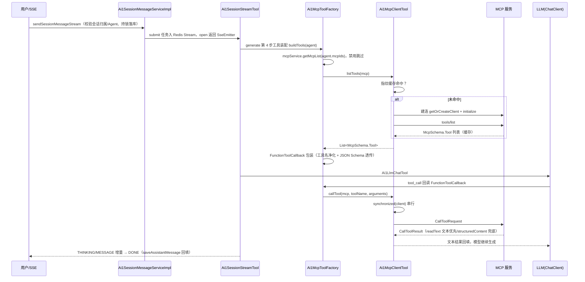

# MCP 工具接口 (Ai1McpController)

> 管理 AI1 模块接入的 MCP（Model Context Protocol）服务：维护「远程 Streamable HTTP / 本地 stdio 进程」两种传输方式的连接配置（平铺列 + config JSON 双写存储），并提供连通测试（initialize + tools/list）。Agent 通过 `mcpIds` 绑定多个 MCP 服务，会话生成时由 harness 层的 `Ai1McpToolFactory` 把 MCP 工具桥接为 Spring AI `ToolCallback` 注册给 ChatClient，由 LLM 以 function calling 方式调用，实际执行落地到 `Ai1McpClientTool`（官方 Java MCP SDK 客户端，按「MCP 编号 + 配置指纹」缓存连接）。

## 接口路径前缀

- `/ai1/mcp` (Controller: Ai1McpController) — MCP 服务管理

---

## 1. 创建 MCP

- **路径**: POST /ai1/mcp/create
- **权限**: ai1:mcp:create
- **说明**: 新增一个 MCP 服务配置（远程 http / 本地 stdio）

**请求参数 (Ai1McpSaveReqVO)**:

| 字段 | 类型 | 必填 | 校验规则 | 说明 |
|-----|------|-----|---------|------|
| id | Long | 新增时否 | - | 编号 |
| name | String | 是 | @NotEmpty、@Size(max = 100) | 名称，如「天气查询」 |
| transport | String | 是 | @NotEmpty、@InEnum(Ai1McpTransportEnum) | 传输方式：`http` 远程（Streamable HTTP）/ `stdio` 本地进程（stdio） |
| url | String | 远程必填 | @Size(max = 200) | 服务地址；为空时取 config 中的 url |
| headers | Map&lt;String, String&gt; | 否 | 序列化后长度 ≤ 500（@AssertTrue 校验） | 请求头，远程配置以此字段为准；为空时清空请求头 |
| config | String | 否（本地必填 command） | 非空时必须为合法 JSON 对象 | 完整 MCP 配置，JSON 对象；本地必填 command |
| status | Integer | 是 | @NotNull、@InEnum(CommonStatusEnum) | 状态（0 开启 / 1 禁用） |
| remark | String | 否 | @Size(max = 500) | 备注 |

**响应**: CommonResult&lt;Long&gt; — MCP 编号

**业务逻辑**: 1. `buildMcp` 校验并归一化配置：config 经 `JsonUtils.parseMap` 解析（非空但解析失败抛 MCP_CONFIG_INVALID）；transport 以平铺列为准写回 `config.transport`；2. stdio 类型：config 必须包含 command（否则抛 MCP_COMMAND_REQUIRED），url 置空；3. http 类型：url 必填（平铺列优先，为空时取 config.url，仍为空抛 MCP_URL_REQUIRED），请求头以平铺列为准归一化写回 config（空集合时从 config 中移除 headers，避免残留旧鉴权）；4. 插入数据库并返回编号。

**错误码**:

| 错误码 | 说明 |
|-------|------|
| 1_041_004_001 | config 配置需为合法的 JSON 对象 |
| 1_041_004_002 | 本地（stdio）类型必须在 config 中配置 command 命令 |
| 1_041_004_003 | 远程（http）类型必须配置服务地址 |

### 1.1 config 与平铺列双写结构

MCP 配置采用「平铺列 + config JSON」双写存储（`Ai1McpDO`，表 `ai1_mcp`）：

| 传输方式 | config JSON 内容 | 平铺列 | 说明 |
|---------|-----------------|-------|------|
| http（远程） | `{transport, url, headers}` | transport / url / headers | url、headers 便于查询与校验 |
| stdio（本地） | `{transport, command, args, env, cwd}` | transport（url 置空） | 客户端构建本地进程时消费 command / args / env（`Ai1McpClientTool#buildStdioTransport`） |

两侧一致性约定：**保存时**（`Ai1McpServiceImpl#buildMcp`）以平铺列为准归一化写回 config；**读取时**（`Ai1McpClientTool#parseConfig`）：url、headers 为 config 优先、平铺列兜底；transport 以平铺列为准，缺失时依次回退 config、http。url、command、headers、env、args 中的 `${ENV}` 占位符在库中保存原文，仅发起调用前经 `Ai1Utils#resolveSpringPlaceholders` 解析（密钥不出库），解析失败抛 CONFIG_PLACEHOLDER_NOT_RESOLVED（1_041_000_006），接口响应仍返回占位符原文。

---

## 2. 更新 MCP

- **路径**: PUT /ai1/mcp/update
- **权限**: ai1:mcp:update
- **说明**: 按编号更新 MCP 配置（含切换传输方式）

**请求参数 (Ai1McpSaveReqVO)**: 同 1，其中 id 必传

**响应**: CommonResult&lt;Boolean&gt; — 固定 true

**业务逻辑**: 1. 校验 MCP 存在（MCP_NOT_EXISTS）；2. `buildMcp` 归一化后经 `Ai1McpMapper#updateForSave` 更新 —— MyBatis-Plus 更新默认跳过 null 字段，切换为 stdio 时 url 为 null，需用 LambdaUpdateWrapper `set(condition, url, null)` 主动置空，否则残留旧地址且 parseConfig 回退平铺列时读到旧值；3. 调用 `Ai1McpClientTool#evict(id)` 释放本节点的旧客户端（含 stdio 子进程），下次使用时按新配置指纹重建。

**错误码**:

| 错误码 | 说明 |
|-------|------|
| 1_041_004_000 | MCP 不存在 |
| 1_041_004_001 / 002 / 003 | 同 1（config 归一化校验） |

> 注意：`evict` 只影响当前 JVM 节点。集群其他节点的旧客户端（含 stdio 子进程）需等待闲置过期（30 分钟 `expireAfterAccess`）或下次访问时因配置指纹变化自然重建。

---

## 3. 删除 MCP

- **路径**: DELETE /ai1/mcp/delete
- **权限**: ai1:mcp:delete
- **说明**: 按编号删除 MCP

**请求参数**: 无（Query 参数 id：Long，必填，编号）

**响应**: CommonResult&lt;Boolean&gt; — 固定 true

**业务逻辑**: 1. 校验 MCP 存在；2. 按 id 删除（TenantBaseDO 逻辑删除）；3. `Ai1McpClientTool#evict` 释放本节点的连接与子进程，其他节点的闲置连接按访问过期自动释放。

> 注意：删除**不校验**该 MCP 是否已被 Agent 绑定（没有类似 MODEL_USED_BY_AGENT 的错误码）。删除后 Agent 的 `mcpIds` 残留悬空编号，会话装配工具时经 `mcpService.getMcpList`（selectByIds 只返回存在的行）静默跳过，无任何报错。

**错误码**:

| 错误码 | 说明 |
|-------|------|
| 1_041_004_000 | MCP 不存在 |

## 4. 批量删除 MCP

- **路径**: DELETE /ai1/mcp/delete-list
- **权限**: ai1:mcp:delete
- **说明**: 按编号列表批量删除 MCP

**请求参数**: 无（Query 参数 ids：List&lt;Long&gt;，必填，编号列表）

**响应**: CommonResult&lt;Boolean&gt; — 固定 true

**业务逻辑**: 与单删同一实现 `Ai1McpService#deleteMcpListByIds(List<Long>)`（单删即单元素列表）：逐个校验存在 → `deleteByIds` 批量删除 → 逐个 `evict` 释放本节点连接与子进程。注意事项同 3。

**错误码**:

| 错误码 | 说明 |
|-------|------|
| 1_041_004_000 | MCP 不存在 |

## 5. 获得 MCP

- **路径**: GET /ai1/mcp/get
- **权限**: ai1:mcp:query
- **说明**: 按编号查询单个 MCP 配置（含 config 原文）

**请求参数**: 无（Query 参数 id：Long，必填，编号）

**响应**: CommonResult&lt;Ai1McpRespVO&gt;

| 字段 | 类型 | 说明 |
|-----|------|------|
| id | Long | 编号 |
| name | String | 名称 |
| transport | String | 传输方式（http / stdio） |
| url | String | 服务地址（本地为空） |
| headers | Map&lt;String, String&gt; | 请求头 |
| config | String | 完整 MCP 配置，JSON 原文 |
| status | Integer | 状态（0 开启 / 1 禁用） |
| remark | String | 备注 |
| createTime | LocalDateTime | 创建时间 |
| updateTime | LocalDateTime | 更新时间 |

**业务逻辑**: 1. 按 id selectById 查询；2. `BeanUtils.toBean` 转 RespVO 返回（不存在时 data 为 null）。响应中的 headers / url / config 均为占位符原文，不做 `${ENV}` 解析。

## 6. 获得 MCP 分页

- **路径**: GET /ai1/mcp/page
- **权限**: ai1:mcp:query
- **说明**: 分页查询 MCP 配置列表

**请求参数 (Ai1McpPageReqVO，继承 PageParam)**:

| 字段 | 类型 | 必填 | 校验规则 | 说明 |
|-----|------|-----|---------|------|
| pageNo / pageSize | Integer | 是 | 同 PageParam（@NotNull、@Min(1)，pageSize @Max(200)，默认 1 / 10） | 分页参数 |
| name | String | 否 | - | 名称，模糊匹配（LIKE） |
| status | Integer | 否 | - | 状态，精确匹配 |

**响应**: CommonResult&lt;PageResult&lt;Ai1McpRespVO&gt;&gt; — 列表项字段同 5

**业务逻辑**: 1. `Ai1McpMapper#selectPage`：name likeIfPresent 模糊、status eqIfPresent 精确；2. 按 id 升序分页返回。

## 7. 获得 MCP 精简列表

- **路径**: GET /ai1/mcp/simple-list
- **权限**: 仅登录（无 @PreAuthorize）
- **说明**: 只包含开启状态，用于 Agent 绑定 MCP 的下拉选择

**请求参数**: 无

**响应**: CommonResult&lt;List&lt;Ai1McpRespVO&gt;&gt;（仅填充 id、name、transport 三个字段）

**业务逻辑**: 1. 按 status=开启（CommonStatusEnum.ENABLE）查询列表，按 id 升序；2. `convertList` 只回填 id、name、transport 三个字段。

> Agent 保存时传 `mcpIds`（`Ai1AgentSaveReqVO.mcpIds`，取值即来自本接口）。无需在 MCP 域做任何改动：会话生成时 `Ai1McpToolFactory#buildTools` 自动按 `agent.mcpIds` 装配，禁用状态服务自动跳过、单个服务 tools/list 失败自动降级（返回空列表），不影响会话。

## 8. MCP 连通测试

- **路径**: POST /ai1/mcp/test
- **权限**: ai1:mcp:test
- **说明**: initialize + tools/list，验证配置能否连通并探明可用工具

**请求参数**: 无（Query 参数 id：Long，必填，编号）

**响应**: CommonResult&lt;Ai1McpConnectRespVO&gt;

| 字段 | 类型 | 说明 |
|-----|------|------|
| connectable | Boolean | 是否连通 |
| serverName | String | 服务名称（initialize 返回的 serverInfo.name） |
| serverVersion | String | 服务版本（serverInfo.version） |
| instructions | String | 服务说明（getServerInstructions） |
| toolCount | Integer | 可用工具数量 |
| elapsedMs | Long | 测试耗时，单位：毫秒 |
| message | String | 测试过程描述（成功为「连接成功，发现 N 个工具」，失败为异常信息） |
| tools | List&lt;Tool&gt; | 可用工具明细 |
| tools[].name | String | 工具名称 |
| tools[].title | String | 工具标题 |
| tools[].description | String | 工具描述 |

**业务逻辑**（`Ai1McpServiceImpl#testMcpConnect` → `Ai1McpClientTool#testConnect`）: 1. 校验 MCP 存在（MCP_NOT_EXISTS）；2. 按 transport 构建传输层 —— http：URI 拆为 base（scheme://authority）+ endpoint（raw path + query，空时回退默认 `/mcp`），headers 经 `McpSyncHttpClientRequestCustomizer` 追加；stdio：`ServerParameters` command / args / env；3. 构建 `McpClient.sync` **临时客户端**（requestTimeout 30s、initializationTimeout 15s，不进缓存）执行 initialize；4. 成功后读取 getServerInfo / getServerInstructions，listTools 映射为 Tool 明细，返回 connectable=true；5. 失败捕获异常返回 connectable=false + message（不抛业务异常），finally `closeGracefully` 关闭临时客户端，全程不读写 clientCache / toolsCache，**测试不污染正式客户端缓存**。

**错误码**:

| 错误码 | 说明 |
|-------|------|
| 1_041_004_000 | MCP 不存在 |
| 1_041_000_006 | 配置({})无法解析，请检查环境变量或配置项（url/command/headers/env/args 中 ${ENV} 占位符解析失败） |

---

## 关键流程

### 1. 消息发送 → LLM 调用 MCP 工具全链路



### 2. MCP 客户端生命周期与失效重建

```mermaid
flowchart TD
    A[访问 listTools / callTool] --> B["buildCacheKey = id + Objects.hash(transport, config, url, headers)"]
    B --> C{clientCache 命中?}
    C -- 是 --> D[直接复用客户端]
    C -- 否 --> E["按 MCP 编号粒度锁（clientLocks）double-check"]
    E --> F[resolveConfig 解析 ${ENV} 占位符]
    F --> G[buildTransport: http 拆 base+endpoint / stdio ServerParameters]
    G --> H[McpClient.sync 建连 requestTimeout 60s]
    H --> I{initialize 成功?}
    I -- 否 --> J[closeQuietly 主动关闭，防止连接/子进程泄漏]
    I -- 是 --> K[clientCache.put + evictExcept 关闭旧指纹客户端]
    K --> D
    D --> L{调用失败?}
    L -- McpError（JSON-RPC 业务错误） --> M[连接有效，原样抛出]
    L -- 其他异常 --> N["双参 remove(cacheKey, client) 成功才连带失效 toolsCache<br/>不自动重跑有副作用的工具"]
    O[配置变更/删除] --> P[evict 本节点按 id: 前缀清理]
    P --> Q[其他节点指纹变化自然 miss 重建<br/>闲置 30 分钟 expireAfterAccess 兜底]
    R[RemovalListener / @PreDestroy] --> S[closeGracefully 释放连接与 stdio 子进程]
```

要点：客户端缓存 key = MCP 编号 + `Objects.hash(transport, config, url, headers)` 配置指纹，配置任一变化即自然 miss 重建；`RemovalListener` 统一 `closeGracefully`，`@PreDestroy` 全量回收；多节点下其他节点不感知 evict，靠指纹变化与闲置过期收敛。

---

## 附：本域错误码汇总（Ai1ErrorCodeConstants，1-041 段）

| 错误码 | 说明 | 触发点 |
|-------|------|--------|
| 1_041_004_000 | MCP 不存在 | 更新 / 删除 / 连通测试前的 `validateMcpExists` |
| 1_041_004_001 | config 配置需为合法的 JSON 对象 | `buildMcp` 中 `JsonUtils.parseMap` 解析失败 |
| 1_041_004_002 | 本地（stdio）类型必须在 config 中配置 command 命令 | `buildMcp` stdio 校验 |
| 1_041_004_003 | 远程（http）类型必须配置服务地址 | `buildMcp` http 校验 |
| 1_041_000_006（共用） | 配置({})无法解析，请检查环境变量或配置项 | `Ai1Utils#resolveSpringPlaceholders` 解析 `${ENV}` 失败（url/command/headers/env/args，建连/调用时） |

## 相关文档

- [api-agent.md](api-agent.md) — Agent 管理（`mcpIds` 绑定 MCP 服务）
- [api-session.md](api-session.md) — 会话与消息发送（工具装配与调用链上游）
- [data-model.md](data-model.md) — `ai1_mcp` 表结构与 ER 关系
