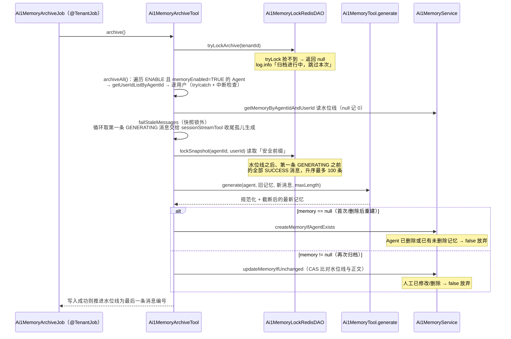

# AI1 长期记忆接口 (Ai1MemoryController)

> 提供 AI1 长期记忆的管理能力（查询、修改、逻辑删除）。长期记忆没有手工创建入口：每个「用户 × Agent」的记忆由归档定时任务 `Ai1MemoryArchiveJob` 基于会话消息按水位线 `lastMessageId` 增量生成，管理端修改正文不影响水位线，删除后由下次归档根据历史对话重新生成。

## 接口路径前缀

- `/ai1/memory` (Controller: Ai1MemoryController)

---

## 1. 长期记忆管理（Ai1MemoryController，需管理员权限）

### 1.1 更新长期记忆

- **路径**: PUT /ai1/memory/update
- **权限**: ai1:memory:update
- **说明**: 更新长期记忆正文。仅允许改 `content`，不提供水位线的修改入口。

**请求参数 (Ai1MemoryUpdateReqVO)**:

| 字段 | 类型 | 必填 | 校验规则 | 说明 |
|-----|------|------|---------|------|
| id | Long | 是 | @NotNull | 编号 |
| content | String | 是 | @NotBlank、@Size(max = 65535) | 记忆正文（Markdown 格式，按维度分节） |

**响应**: CommonResult\<Boolean\>（true）

**业务逻辑**: 1. 校验记忆存在，否则抛 MEMORY_NOT_EXISTS。2. `BeanUtils.toBean` 转 `Ai1MemoryDO` 后 `updateById` 更新。3. **水位线 `lastMessageId` 不变**：之后的归档在写入前会比对正文，检测到人工修改时放弃本次生成结果（见 3.3「写入前 CAS 校验」），保证人工修改不被归档覆盖。

**错误码**:

| 错误码 | 说明 |
|-------|------|
| 1-041-010-000 | 长期记忆不存在 |

### 1.2 删除长期记忆

- **路径**: DELETE /ai1/memory/delete
- **权限**: ai1:memory:delete
- **说明**: 删除指定长期记忆（逻辑删除）。**之后根据历史对话重新生成**。

**请求参数**: Query 参数

| 字段 | 类型 | 必填 | 校验规则 | 说明 |
|-----|------|------|---------|------|
| id | Long | 是 | @RequestParam | 编号 |

**响应**: CommonResult\<Boolean\>（true）

**业务逻辑**: 1. `deleteMemory(id)` 内部委托 `deleteMemoryListByIds(singletonList(id))`。2. 逐个校验记忆存在，否则抛 MEMORY_NOT_EXISTS。3. `memoryMapper.deleteByIds` 走 MyBatis-Plus 逻辑删除（`deleted` 标记），保留历史记录便于追溯。4. 进行中的归档写入会因记录已删除（`updateMemoryIfUnchanged` 读不到）而放弃；下次归档经 `createMemoryIfAgentExists` 基于历史消息重新生成新记录。

**错误码**:

| 错误码 | 说明 |
|-------|------|
| 1-041-010-000 | 长期记忆不存在 |

### 1.3 批量删除长期记忆

- **路径**: DELETE /ai1/memory/delete-list
- **权限**: ai1:memory:delete
- **说明**: 批量删除长期记忆（逻辑删除）。**之后根据历史对话重新生成**。

**请求参数**: Query 参数

| 字段 | 类型 | 必填 | 校验规则 | 说明 |
|-----|------|------|---------|------|
| ids | List\<Long\> | 是 | @RequestParam | 编号列表 |

**响应**: CommonResult\<Boolean\>（true）

**业务逻辑**: 1. 编号列表为空时直接返回。2. 逐个校验记忆存在，任一不存在抛 MEMORY_NOT_EXISTS。3. `memoryMapper.deleteByIds` 批量逻辑删除。

**错误码**:

| 错误码 | 说明 |
|-------|------|
| 1-041-010-000 | 长期记忆不存在 |

### 1.4 获得长期记忆

- **路径**: GET /ai1/memory/get
- **权限**: ai1:memory:query
- **说明**: 按编号获得长期记忆详情，附带 Agent 名称与用户昵称。

**请求参数**: Query 参数

| 字段 | 类型 | 必填 | 校验规则 | 说明 |
|-----|------|------|---------|------|
| id | Long | 是 | @RequestParam | 编号 |

**响应**: CommonResult\<Ai1MemoryRespVO\>

| 字段 | 类型 | 说明 |
|------|------|------|
| id | Long | 编号 |
| agentId | Long | Agent 编号 |
| agentName | String | Agent 名称（关联拼接） |
| userId | Long | 用户编号 |
| userNickname | String | 用户昵称（关联拼接） |
| content | String | 记忆正文（Markdown 格式，按维度分节） |
| lastMessageId | Long | 已归档的最后一条消息编号（增量归档水位线） |
| createTime | LocalDateTime | 创建时间 |
| updateTime | LocalDateTime | 更新时间 |

**业务逻辑**: 1. `memoryService.getMemory(id)` 按 id 查询（`selectById`）。2. `buildMemoryRespVO` 复用 `buildMemoryRespVOList` 拼接：`agentService.getAgentMap` 批量取 Agent 填充 `agentName`；`AdminUserApi.getUserMap` + `MapUtils.findAndThen` 填充 `userNickname`。3. 记录不存在时返回 null。

### 1.5 获得长期记忆分页

- **路径**: GET /ai1/memory/page
- **权限**: ai1:memory:query
- **说明**: 分页查询全部长期记忆，支持按 Agent、用户过滤，附带 Agent 名称与用户昵称。

**请求参数 (Ai1MemoryPageReqVO，继承 PageParam)**:

| 字段 | 类型 | 必填 | 校验规则 | 说明 |
|-----|------|------|---------|------|
| agentId | Long | 否 | - | Agent 编号 |
| userId | Long | 否 | - | 用户编号 |
| pageNo | Integer | 否 | PageParam | 页码 |
| pageSize | Integer | 否 | PageParam | 每页条数 |

**响应**: CommonResult\<PageResult\<Ai1MemoryRespVO\>\>（字段同 1.4）

**业务逻辑**: 1. `Ai1MemoryMapper.selectPage` 用 `LambdaQueryWrapperX` 对 `agentId`、`userId` 做 `eqIfPresent` 精确匹配，按 `id` 降序排序。2. `buildMemoryRespVOList` 批量拼接 `agentName`（`Ai1AgentService.getAgentMap`）与 `userNickname`（`AdminUserApi.getUserMap`）后返回。

---

## 2. 数据模型

**表 `ai1_memory`**（DO: `Ai1MemoryDO`，继承 `TenantBaseDO`，含 `tenant_id`、`creator/create_time/updater/update_time/deleted` 逻辑删除）：

| 字段 | 类型 | 说明 |
|-----|------|------|
| id | Long | 编号（@TableId） |
| agent_id | Long | Agent 编号，关联 `Ai1AgentDO#getId()` |
| user_id | Long | 用户编号，关联 `AdminUserDO` 的 id |
| content | mediumtext | 记忆正文，Markdown 格式，按维度分节 |
| last_message_id | bigint NOT NULL DEFAULT 0 | 已归档的最后一条消息编号，关联 `Ai1SessionMessageDO#getId()`，即增量归档水位线 |

**关键约定**：

- 每个用户在每个 Agent 下只有一条未删除记忆；表未加 `(agent_id, user_id)` 唯一索引，极端并发下可能产生重复记录，`Ai1MemoryMapper.selectByAgentIdAndUserId` 用 `selectFirstOne` 取第一条容忍（同租户归档由归档锁串行，重复概率极低；如需加索引须先清理存量重复数据）。
- 删除为逻辑删除，之后的归档会根据历史消息生成新的记录；不要改用物理删除，否则丢失追溯能力。

---

## 3. 记忆的生成与注入（与 harness 组件的协作）

管理端 5 个接口只是长期记忆域的「人工兜底」，记忆的生命周期主要由 harness 层组件闭环：

| 组件 | 所在包 | 职责 |
|-----|-------|------|
| `Ai1MemoryTool` | harness/memory | 运行时工具：`loadMemory` 读记忆、`mergePrompt` 把记忆合并进系统指令、`generate` 经模型按固定维度生成最新记忆。持久化不在这里做 |
| `Ai1MemoryArchiveTool` | harness/memory | 归档编排：由 Job 按租户触发，逐 Agent、逐用户把水位线后的新消息归档为记忆 |
| `Ai1MemoryArchiveJob` | job | 定时任务入口（`JobHandler` + `@TenantJob`），infra_job 中 `handlerName=ai1MemoryArchiveJob`，按租户逐个执行 |
| `Ai1MemoryLockRedisDAO` | dal/redis/memory | 封装 Redisson RLock：归档锁（tryLock 不等待）与快照锁（lock 阻塞等待） |
| `Ai1MemoryServiceImpl` | service/memory | 人工写路径（update/delete）抛 `MEMORY_NOT_EXISTS`；归档写路径（`createMemoryIfAgentExists`/`updateMemoryIfUnchanged`）不抛异常，以 boolean 返回是否写入成功，冲突时静默放弃 |

### 3.1 记忆维度与生成约束

`Ai1MemoryTool.MEMORY_SECTIONS` 定义五个固定维度：**用户画像、偏好习惯、关键事实、目标与意图、近期进展**。`MEMORY_SYSTEM_PROMPT` 约束模型只输出 Markdown 正文、每个维度标题独占一行（`## 维度名`）、要点以 `- ` 开头，总长度不超过 `{maxLen}` 字（占位符替换为 `yudao.ai1.memory.max-length`，默认 `2000`，即 `YudaoAi1Properties.Memory.DEFAULT_MAX_LENGTH`）。

`generate` 是刻意的**单轮裸调用**：系统提示为 `MEMORY_SYSTEM_PROMPT`，用户提示为「【历史记忆】+【最新对话】」（assistant 角色显示为「助手」，否则「用户」），历史消息、MCP/SKILL 工具、RAG Advisor 全传空集合、sessionId 传 null——不要往这里加工具或记忆注入，否则会产生递归（记忆生成再触发记忆）或上下文污染。调用前经 `Ai1ModelTypeEnum.isChat` 校验 Agent 对话模型，非 CHAT 类型抛 MODEL_TYPE_NOT_CHAT（归档按单用户失败处理）。输出经 `Ai1Utils.normalizeMemoryMarkdown` 规范化（按维度标题拆行、列表标记补空格，避免误拆 C#、#123、URL 锚点，不把中文破折号 — – 当列表标记）+ `Ai1Utils.limitLength` 截断（不拆开 UTF-16 代理对）后返回。

### 3.2 记忆注入（对话时）

Agent 开启 `memoryEnabled` 后，`Ai1SessionStreamTool.generate` 在组装系统指令的第 3 步调用私有方法 `injectMemory`：

1. `agent.getMemoryEnabled() != TRUE` 时直接返回原指令。
2. `sessionService.getSession(sessionId)` 取 `userId`，再 `memoryTool.loadMemory(agent.getId(), userId)`（内部 `getMemoryByAgentIdAndUserId` → `selectFirstOne` 取第一条）。
3. `memoryTool.mergePrompt(basePrompt, memory)` 在系统指令末尾追加引导语（「以下是该用户的历史长期记忆（Markdown）……若与用户当前表述冲突，以当前表述为准」）+ 记忆正文。
4. 查询抛异常时 `log.warn` 降级为原系统指令——记忆属于增强能力，任何故障都不阻断主对话。

### 3.3 记忆归档（定时任务）

**安全前缀与孤儿生成**：新消息只取「截止到水位线之后第一条 GENERATING 消息（不含）」的 SUCCESS 消息，避免水位线越过尚未完成的回复；超时且无 worker 执行的孤儿 GENERATING 消息先按中断收尾（标 FAILED 并写 error/done 终态），否则会永久阻塞安全前缀。收尾故意放在快照锁**外**执行（需抢消息执行锁并读写结果流），快照锁持有期间不收尾、不调用模型。

**三层并发控制**：

| 层 | 机制 | Redis Key | 行为 |
|----|------|-----------|------|
| 租户归档锁 | `tryLockArchive` | `ai1:memory:archive-lock:{tenantId}` | tryLock 不等待，抢不到直接跳过本次（多节点部署时同租户归档单节点执行，是有意的削峰设计，不要把返回 0 当异常） |
| 用户快照锁 | `lockSnapshot` | `ai1:memory:snapshot-lock:{agentId}:{userId}` | lock() 阻塞等待；发送消息侧以它包住 `createRoundMessages`（同一事务落库用户消息与助手占位，锁持有到事务提交），归档读侧持同一把锁读取，保证读取时不存在编号更小、尚未提交的消息，避免低编号消息晚提交后落在水位线之前被永久跳过（Agent 编号全局唯一故 KEY 不带 tenantId） |
| 写入前 CAS | `createMemoryIfAgentExists` / `updateMemoryIfUnchanged` | - | 写入前重新 `selectById` 比对水位线与正文，检测到人工修改/删除/Agent 删除时放弃本次生成结果（返回 false + log.info），保证人工操作不被覆盖，且不依赖数据库行锁 |

两把 Redis 锁均不设置 leaseTime，由 Redisson 看门狗续期；归档锁 unlock 前用 `isHeldByCurrentThread` 校验持有者，快照锁由 `lock()` 阻塞获取、必然由当前线程持有，直接 unlock。锁顺序固定为「归档锁 → 消息执行锁（tryLock）」。

**批量与容错**：单用户单次最多归档 `BATCH_SIZE = 100` 条消息，剩余由下次执行继续；`archiveAll` 对每个用户 try/catch（`log.warn` 后继续，单用户失败不影响其他用户），并在每轮循环前检查 `Thread.currentThread().isInterrupted()` 以支持 Job 停止时快速退出。归档期间人工修改了记忆正文时，紧接的一轮归档会被整体放弃且水位线不推进（这批消息会重复喂给模型），下次执行基于已含人工修改的旧快照重新归档，最终不丢数据、只是延迟一轮。

**级联删除**：`Ai1MemoryServiceImpl.deleteMemoryListByAgentIds` 由 `Ai1AgentServiceImpl.deleteAgentListByIds`（`@Transactional`）在删除 Agent 的同一事务中调用，按 `agentId` 批量删除记忆。

### 3.4 错误码

`Ai1ErrorCodeConstants` 整体使用 1-041-000-000 段，长期记忆占 1-041-010-000 子段，仅 1 个专属错误码：

| 错误码 | 常量 | 说明 | 触发场景 |
|-------|------|------|---------|
| 1-041-010-000 | `MEMORY_NOT_EXISTS` | 长期记忆不存在 | update / delete / delete-list 校验失败时抛出 |
| 1-041-001-005 | `MODEL_TYPE_NOT_CHAT` | 所选模型不是对话模型 | `Ai1MemoryTool.generate` 校验 Agent 对话模型失败时抛出（归档中按单用户失败处理） |

并发冲突（重复插入 / 写入被放弃）**不抛错误码**，以返回 false + `log.info` 静默处理。

---

## 相关文档

- [api-session.md](api-session.md) —— 会话与会话消息：记忆的数据来源（安全前缀取 SUCCESS 消息）、流式生成与消息执行锁
- [api-agent.md](api-agent.md) —— Agent 管理：`memoryEnabled` 开关、对话模型引用、删除 Agent 时级联删除记忆
- [api-model.md](api-model.md) —— 供应商与模型：记忆生成所用的对话模型（须为 CHAT 类型）
- [data-model.md](data-model.md) —— `ai1_memory` 完整表结构与 ER 关系
