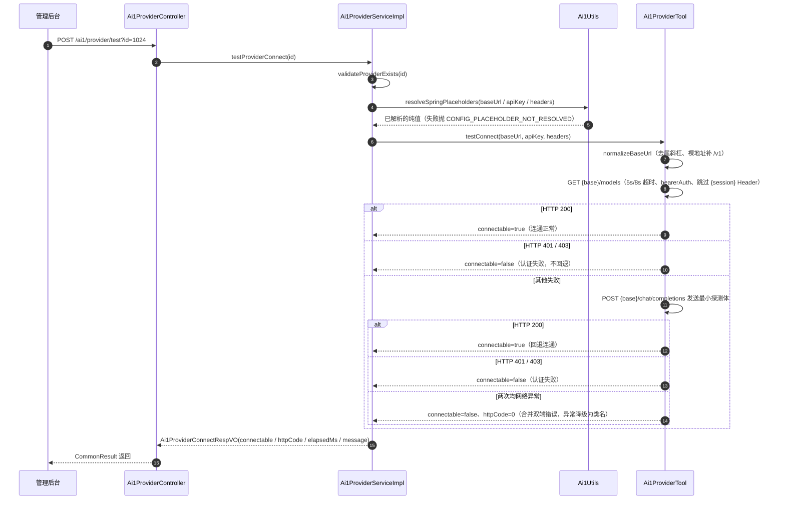
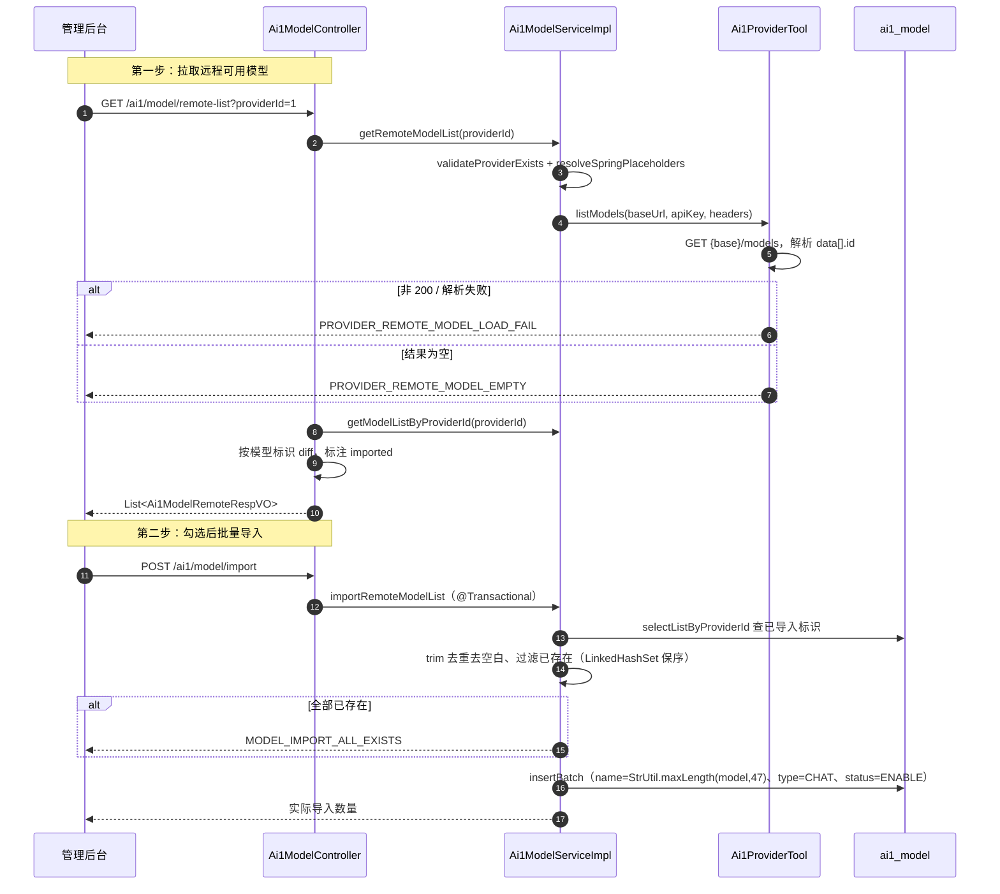
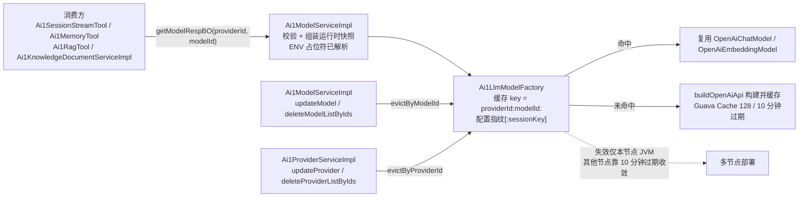

# AI1 模型与供应商（供应商/模型）接口 (Ai1ProviderController / Ai1ModelController)

> 管理 AI1 平台 LLM 接入层的底层配置：供应商（OpenAI 兼容端点的接口地址、API 密钥与自定义请求 Header）与模型（供应商下的具体模型标识与类型）。与旧 ai 模块按平台枚举硬编码多家 SDK 不同，ai1 全量通过 Spring AI 的 `OpenAiChatModel` / `OpenAiEmbeddingModel` 以 OpenAI 兼容协议统一接入 DeepSeek、GLM、Ollama(/v1) 等任意供应商。本域另提供供应商连通测试、远程模型拉取与批量导入能力，并向 Agent 会话、知识库向量化、RAG、长期记忆等上游输出统一的运行时快照 `Ai1ModelRespBO`。

## 接口路径前缀

- `/ai1/provider` (Controller: Ai1ProviderController) — AI1 供应商管理
- `/ai1/model` (Controller: Ai1ModelController) — AI1 模型管理

---

## 1. 供应商（Ai1ProviderController）

> 供应商即「模型提供方」，对应一个 OpenAI 兼容端点。`apiKey` 支持 `${ENV}` Spring 占位符存储（库中不落明文密钥，调用前才解析）；`headers` 支持 `{session}` 会话占位符。所有查询接口对 `apiKey` 脱敏返回；更新时 `apiKey` 传空表示保持原密钥。

### 1.1 创建供应商

- **路径**: POST /ai1/provider/create
- **权限**: ai1:provider:create
- **说明**: 新增一个供应商（OpenAI 兼容端点）配置

**请求参数 (Ai1ProviderSaveReqVO)**:

| 字段 | 类型 | 必填 | 校验规则 | 说明 |
|-----|------|-----|---------|------|
| id | Long | 新增时否 | - | 编号 |
| name | String | 是 | @NotEmpty、@Size(max = 50) | 名称，如「DeepSeek」 |
| baseUrl | String | 是 | @NotEmpty、@Size(max = 200) | 接口地址，如 `https://api.deepseek.com/v1`；裸地址（无路径，如 Ollama 的 `http://127.0.0.1:11434`）调用时自动补 `/v1` |
| apiKey | String | 否 | @Size(max = 200) | API 密钥，如 `sk-xxx`；支持 `${ENV}` 占位符（如 `${DEEPSEEK_API_KEY}`）；本地端点可不填 |
| headers | Map&lt;String, String&gt; | 否 | @AssertTrue（`Ai1Utils.isHeadersValid`） | 请求 Header，JSON 对象；值可含 `{session}` 占位符，示例 `{"X-Session":"{session}"}` |
| status | Integer | 是 | @NotNull、@InEnum(CommonStatusEnum) | 状态（0 开启 / 1 禁用） |
| remark | String | 否 | @Size(max = 255) | 备注 |

**响应**: CommonResult&lt;Long&gt; — 供应商编号

**业务逻辑**:
1. VO 转换为 `Ai1ProviderDO`，其中 headers 先经 `Ai1Utils.normalizeHeaders` 规范化：key trim、大小写不敏感去重、拒绝空 key / null value、序列化 JSON 长度 ≤ 2000，非法抛 PROVIDER_HEADERS_INVALID；
2. 插入数据库，返回新记录编号。

> headers 的合法性在 VO 校验阶段已由 `@AssertTrue` 拦截一次（内部同样走 `normalizeHeaders`），Service 层再规范化一次以保证入库顺序与内容一致。

**错误码**:

| 错误码 | 说明 |
|-------|------|
| 1_041_000_007 | 请求 Header 格式不正确或名称重复，请检查供应商配置 |

### 1.2 更新供应商

- **路径**: PUT /ai1/provider/update
- **权限**: ai1:provider:update
- **说明**: 按编号更新供应商（API 密钥为空表示保持原密钥）

**请求参数 (Ai1ProviderSaveReqVO)**: 同 1.1，其中 id 必传

**响应**: CommonResult&lt;Boolean&gt; — 固定 true

**业务逻辑**:
1. 校验供应商存在，不存在抛 PROVIDER_NOT_EXISTS；
2. VO 转 DO：headers 同样 normalizeHeaders；`apiKey` 为空白时显式置 null，借 MyBatis-Plus `updateById` 跳过 null 字段从而保持数据库原密钥；
3. 更新后调用 `Ai1LlmModelFactory.evictByProviderId` 失效本节点该供应商下全部模型实例缓存（地址、密钥、Header、状态都可能变化）。

> **注意**：查询接口返回的 `apiKey` 是脱敏值（见 1.5）。前端若把回显的脱敏串原样提交（非空），会被存成 `sk-****abcd` 这类废密钥，下次调用必然鉴权失败。正确交互是：修改密钥时填新值，不修改时输入框留空。

### 1.3 删除供应商

- **路径**: DELETE /ai1/provider/delete
- **权限**: ai1:provider:delete
- **说明**: 按编号删除供应商

**请求参数**: 无（Query 参数 id：Long，必填，编号）

**响应**: CommonResult&lt;Boolean&gt; — 固定 true

**业务逻辑**（`deleteProvider` 委托 `deleteProviderListByIds`，`@Transactional`）:
1. 校验供应商存在；
2. 调用 `Ai1ModelService.getModelCountByProviderIds` 检查其下是否还有模型，大于 0 抛 PROVIDER_HAS_MODEL 禁止删除；
3. `providerMapper.deleteByIds` 删除；
4. 逐 id 调用 `llmModelFactory.evictByProviderId` 失效本节点缓存。

**错误码**:

| 错误码 | 说明 |
|-------|------|
| 1_041_000_000 | 供应商不存在 |
| 1_041_000_003 | 供应商下存在模型，禁止删除 |

### 1.4 批量删除供应商

- **路径**: DELETE /ai1/provider/delete-list
- **权限**: ai1:provider:delete
- **说明**: 按编号列表批量删除供应商

**请求参数**: 无（Query 参数 ids：List&lt;Long&gt;，必填，编号列表）

**响应**: CommonResult&lt;Boolean&gt; — 固定 true

**业务逻辑**: 同 1.3 的批量版本——存在性校验 + 供应商下模型数量校验（任一 id 下有模型即抛 PROVIDER_HAS_MODEL）+ `deleteByIds` 批量删除 + 逐 id `evictByProviderId`。

### 1.5 获得供应商（apiKey 脱敏）

- **路径**: GET /ai1/provider/get
- **权限**: ai1:provider:query
- **说明**: 按编号查询单个供应商，apiKey 脱敏返回

**请求参数**: 无（Query 参数 id：Long，必填，编号）

**响应**: CommonResult&lt;Ai1ProviderRespVO&gt;

| 字段 | 类型 | 说明 |
|-----|------|------|
| id | Long | 编号 |
| name | String | 名称 |
| baseUrl | String | 接口地址 |
| apiKey | String | API 密钥，脱敏展示（见下方规则） |
| headers | Map&lt;String, String&gt; | 请求 Header，JSON 对象 |
| status | Integer | 状态 |
| remark | String | 备注 |
| createTime | LocalDateTime | 创建时间 |
| updateTime | LocalDateTime | 更新时间 |

**业务逻辑**（Controller 私有方法 `buildProviderRespVO` 脱敏）:
1. 查询 DO 后 `BeanUtils` 转 RespVO；
2. apiKey 脱敏规则：仅完整的 `${VAR}` 变量占位符（正则 `^\$\{[a-zA-Z_][a-zA-Z0-9_.-]*\}$`）原样返回；其余非空密钥长度 ≤ 8 置 `"****"`，长度 > 8 用 `StrUtil.hide(apiKey, 3, length - 4)` 中段打码；
3. 带默认值或拼接内容的占位符密钥仍按普通密钥脱敏，避免查询权限直接获取完整密钥。

### 1.6 获得供应商分页

- **路径**: GET /ai1/provider/page
- **权限**: ai1:provider:query
- **说明**: 分页查询供应商列表，apiKey 脱敏

**请求参数 (Ai1ProviderPageReqVO，继承 PageParam)**:

| 字段 | 类型 | 必填 | 校验规则 | 说明 |
|-----|------|-----|---------|------|
| pageNo | Integer | 是 | @NotNull、@Min(1)（继承自 PageParam，默认 1） | 页码，从 1 开始 |
| pageSize | Integer | 是 | @NotNull、@Min(1)、@Max(200)（继承自 PageParam，默认 10） | 每页条数 |
| name | String | 否 | - | 名称，模糊匹配 |
| status | Integer | 否 | - | 状态 |

**响应**: CommonResult&lt;PageResult&lt;Ai1ProviderRespVO&gt;&gt; — 列表项字段同 1.5

**业务逻辑**: 1. 按名称 LIKE、状态等值条件构造查询（`Ai1ProviderMapper.selectPage`），按 id 升序；2. 逐条经 `buildProviderRespVO` 脱敏后组装 PageResult 返回。

### 1.7 获得供应商精简列表

- **路径**: GET /ai1/provider/simple-list
- **权限**: 仅登录（无 @PreAuthorize）
- **说明**: 只包含开启状态的供应商，用于 Agent 模型、知识库向量化模型的供应商下拉选择

**请求参数**: 无

**响应**: CommonResult&lt;List&lt;Ai1ProviderRespVO&gt;&gt;（仅填充 id、name 两个字段）

**业务逻辑**: 1. 按 status = ENABLE 查询供应商列表（`getProviderListByStatus`）；2. 转换为仅含 id、name 的精简 RespVO 返回。

### 1.8 供应商连通测试

- **路径**: POST /ai1/provider/test
- **权限**: ai1:provider:test
- **说明**: GET /models 优先，失败时回退 POST /chat/completions

**请求参数**: 无（Query 参数 id：Long，必填，供应商编号）

**响应**: CommonResult&lt;Ai1ProviderConnectRespVO&gt;

| 字段 | 类型 | 说明 |
|-----|------|------|
| connectable | Boolean | 是否连通 |
| httpCode | Integer | 最近一次请求的 HTTP 状态码，0 表示网络异常未收到响应 |
| elapsedMs | Long | 测试耗时，单位：毫秒 |
| message | String | 测试过程描述 |

**业务逻辑**:
1. 校验供应商存在（`validateProviderExists`）；
2. 经 `Ai1Utils.resolveSpringPlaceholders` 解析 baseUrl / apiKey / headers 中的 `${ENV}` 占位符（解析失败抛 CONFIG_PLACEHOLDER_NOT_RESOLVED），库中原文不改；
3. 调用 harness 层 `Ai1ProviderTool.testConnect`：先 `normalizeBaseUrl` 归一化地址（去尾斜杠、裸地址补 `/v1`），再发 GET `{baseUrl}/models`（hutool `HttpRequest`，连接 5s / 读取 8s 超时，`bearerAuth` 携带密钥，值含 `{session}` 占位符的 Header 跳过），HTTP 200 即连通；401 / 403 直接判定认证失败、不再回退；否则回退 POST `{baseUrl}/chat/completions` 发送最小探测体 `{"model":"test","messages":[{"role":"user","content":"hi"}]}`（仅探测可达与鉴权，不做真实会话）；两次都网络异常时合并 httpCode=0 与双端错误信息；
4. 组装 connectable / httpCode / elapsedMs / message 返回。

**message 取值与判定语义**:

| 场景 | connectable | httpCode | message 示例 |
|------|------------|----------|-------------|
| GET /models 返回 200 | true | 200 | 连通正常：GET /models 返回 HTTP 200 |
| GET /models 返回 401 / 403 | false | 401 / 403 | 认证失败：GET /models 返回 HTTP xxx，请检查 API 密钥（不回退） |
| 回退 POST /chat/completions 返回 200 | true | 200 | GET /models 不可用（HTTP xxx），回退 POST /chat/completions 连通正常：HTTP 200 |
| 回退请求返回 401 / 403 | false | 401 / 403 | 认证失败：POST /chat/completions 返回 HTTP xxx，请检查 API 密钥 |
| 回退请求返回其他状态码 | false | 实际码 | 服务可达但接口异常：GET /models HTTP xxx，POST /chat/completions HTTP xxx |
| 两次均网络异常 | false | 0 | 连接失败：GET /models 失败：…；POST /chat/completions 失败：… |

> **注意**：网络异常信息被降级为异常类名（如 `ConnectException`）而非 `e.getMessage()` 原文——HTTP 客户端异常可能包含密钥或 Header 原文，不能直接回传前端；排查连通问题需看服务端日志。

---

## 2. 模型（Ai1ModelController）

> 模型挂在供应商之下，业务唯一性约束为「同一 providerId 下 model（模型标识）唯一」，该约束仅由 Service 层先查后插保证，DDL 无唯一索引兜底。类型分对话（0）与嵌入（1）；模型删除与修改类型受 Agent、知识库引用计数保护，模型的 providerId 不可变更。

### 2.1 创建模型

- **路径**: POST /ai1/model/create
- **权限**: ai1:model:create
- **说明**: 在指定供应商下新增一个模型登记

**请求参数 (Ai1ModelSaveReqVO)**:

| 字段 | 类型 | 必填 | 校验规则 | 说明 |
|-----|------|-----|---------|------|
| id | Long | 新增时否 | - | 编号 |
| providerId | Long | 是 | @NotNull | 供应商编号；创建后不可变更 |
| name | String | 是 | @NotEmpty、@Size(max = 50) | 展示名称，如「DeepSeek Chat」 |
| model | String | 是 | @NotEmpty、@Size(max = 100) | 模型标识，如 `deepseek-chat`、`gpt-4o` |
| type | Integer | 是 | @NotNull、@InEnum(Ai1ModelTypeEnum) | 类型（0 对话 / 1 嵌入） |
| status | Integer | 是 | @NotNull、@InEnum(CommonStatusEnum) | 状态（0 开启 / 1 禁用） |

**响应**: CommonResult&lt;Long&gt; — 模型编号

**业务逻辑**:
1. `providerService.validateProviderExists` 校验供应商存在（不存在抛 PROVIDER_NOT_EXISTS）；
2. 私有方法 `validateModelUnique` 以 `modelMapper.selectByProviderIdAndModel` 校验同一供应商下模型标识唯一，重复抛 MODEL_DUPLICATE；
3. `BeanUtils.toBean` 转 `Ai1ModelDO` 后 `modelMapper.insert`，返回自增编号。

**错误码**:

| 错误码 | 说明 |
|-------|------|
| 1_041_000_000 | 供应商不存在 |
| 1_041_001_002 | 模型标识({}) 已存在 |

### 2.2 更新模型

- **路径**: PUT /ai1/model/update
- **权限**: ai1:model:update
- **说明**: 按编号更新模型（供应商不可变更、被引用时禁改类型）

**请求参数 (Ai1ModelSaveReqVO)**: 同 2.1，其中 id 必传

**响应**: CommonResult&lt;Boolean&gt; — 固定 true

**业务逻辑**:
1. `validateModelExists` 校验模型存在（MODEL_NOT_EXISTS）；
2. `ObjUtil.notEqual` 检查 providerId 不可变更（与原值不同抛 MODEL_NOT_BELONG_PROVIDER），再校验新 providerId 对应供应商存在；
3. `validateModelUnique` 校验同供应商下模型标识唯一（排除自身）；
4. 若修改了 type：依次查 `agentService.getAgentCountByModelIds` 与 `knowledgeBaseService.getKnowledgeBaseCountByEmbeddingModelIds`，被引用则分别抛 MODEL_TYPE_USED_BY_AGENT / MODEL_TYPE_USED_BY_KNOWLEDGE_BASE（避免 Agent 或知识库配置失效）；
5. 更新数据库后调用 `llmModelFactory.evictByModelId` 失效本节点该模型的实例缓存。

**错误码**:

| 错误码 | 说明 |
|-------|------|
| 1_041_001_000 | 模型不存在 |
| 1_041_001_004 | 模型不属于该供应商 |
| 1_041_001_002 | 模型标识({}) 已存在 |
| 1_041_001_009 | 模型已被 Agent 使用，禁止修改类型 |
| 1_041_001_010 | 模型已被知识库使用，禁止修改类型 |

### 2.3 删除模型

- **路径**: DELETE /ai1/model/delete
- **权限**: ai1:model:delete
- **说明**: 按编号删除模型

**请求参数**: 无（Query 参数 id：Long，必填，编号）

**响应**: CommonResult&lt;Boolean&gt; — 固定 true

**业务逻辑**（`deleteModel` 委托 `deleteModelListByIds`，`@Transactional`）:
1. 逐个 `validateModelExists` 校验存在；
2. `agentService.getAgentCountByModelIds` > 0 抛 MODEL_USED_BY_AGENT；`knowledgeBaseService.getKnowledgeBaseCountByEmbeddingModelIds` > 0 抛 MODEL_USED_BY_KNOWLEDGE_BASE，禁止删除；
3. `modelMapper.deleteByIds` 删除；
4. 逐 id 调用 `llmModelFactory.evictByModelId` 失效本节点缓存。

**错误码**:

| 错误码 | 说明 |
|-------|------|
| 1_041_001_000 | 模型不存在 |
| 1_041_001_003 | 模型已被 Agent 使用，禁止删除 |
| 1_041_001_008 | 模型已被知识库使用，禁止删除 |

### 2.4 批量删除模型

- **路径**: DELETE /ai1/model/delete-list
- **权限**: ai1:model:delete
- **说明**: 按编号列表批量删除模型

**请求参数**: 无（Query 参数 ids：List&lt;Long&gt;，必填，编号列表）

**响应**: CommonResult&lt;Boolean&gt; — 固定 true

**业务逻辑**: 同 2.3 的批量版本——存在性校验 + Agent / 知识库引用校验（对整个 ids 集合计数）+ `deleteByIds` 批量删除 + 逐 id `evictByModelId`。

### 2.5 获得模型

- **路径**: GET /ai1/model/get
- **权限**: ai1:model:query
- **说明**: 按编号查询单个模型

**请求参数**: 无（Query 参数 id：Long，必填，编号）

**响应**: CommonResult&lt;Ai1ModelRespVO&gt;

| 字段 | 类型 | 说明 |
|-----|------|------|
| id | Long | 编号 |
| providerId | Long | 供应商编号 |
| name | String | 展示名称 |
| model | String | 模型标识 |
| type | Integer | 类型（0 对话 / 1 嵌入） |
| status | Integer | 状态 |
| createTime | LocalDateTime | 创建时间 |

**业务逻辑**: 1. `modelService.getModel` 按 id `selectById` 查询；2. `BeanUtils.toBean` 转 RespVO 返回（不校验存在，查不到返回 null data）。

### 2.6 获得模型分页

- **路径**: GET /ai1/model/page
- **权限**: ai1:model:query
- **说明**: 分页查询指定供应商下的模型列表

**请求参数 (Ai1ModelPageReqVO，继承 PageParam)**:

| 字段 | 类型 | 必填 | 校验规则 | 说明 |
|-----|------|-----|---------|------|
| pageNo / pageSize | Integer | 是 | 同 PageParam（见 1.6） | 分页参数 |
| providerId | Long | 是 | @NotNull | 供应商编号，精确匹配 |
| name | String | 否 | - | 展示名称，模糊匹配 |
| type | Integer | 否 | - | 类型，精确匹配 |

**响应**: CommonResult&lt;PageResult&lt;Ai1ModelRespVO&gt;&gt; — 列表项字段同 2.5

**业务逻辑**: 1. `Ai1ModelMapper.selectPage` 按 providerId 精确、name LIKE、type 精确条件构造查询，按 id 升序；2. `BeanUtils.toBean` 转 VO 分页返回。

### 2.7 获得模型精简列表

- **路径**: GET /ai1/model/simple-list
- **权限**: 仅登录（无 @PreAuthorize）
- **说明**: 只包含开启状态，用于 Agent 模型、知识库向量化模型的下拉选择

**请求参数**: Query 参数

| 字段 | 类型 | 必填 | 校验规则 | 说明 |
|-----|------|-----|---------|------|
| providerId | Long | 否 | - | 供应商编号，可选过滤 |
| type | Integer | 否 | - | 类型（0 对话 / 1 嵌入），可选过滤 |

**响应**: CommonResult&lt;List&lt;Ai1ModelRespVO&gt;&gt;（仅填充 id、providerId、name、model、type 五个字段）

**业务逻辑**: 1. 调用 `getModelListByProviderIdAndTypeAndStatus(providerId, type, CommonStatusEnum.ENABLE.getStatus())`——providerId / type 可空不过滤，status 固定为开启；2. `convertList` 手工映射为精简 RespVO 返回（不含 status / createTime）。

### 2.8 拉取供应商远程可用模型

- **路径**: GET /ai1/model/remote-list
- **权限**: ai1:model:import
- **说明**: 拉取供应商远程可用模型，并标注是否已导入

**请求参数**: 无（Query 参数 providerId：Long，必填，供应商编号）

**响应**: CommonResult&lt;List&lt;Ai1ModelRemoteRespVO&gt;&gt;

| 字段 | 类型 | 说明 |
|-----|------|------|
| model | String | 远程模型标识，如 `deepseek-chat` |
| imported | Boolean | 是否已导入当前供应商 |

**业务逻辑**:
1. `modelService.getRemoteModelList(providerId)`：校验供应商存在后，经 `resolveSpringPlaceholders` 解析三要素，调用 harness 层 `Ai1ProviderTool.listModels` 发 GET `{baseUrl}/models`，`JsonUtils.parseMap` 解析 `data[].id`；
2. 拉取失败（非 200 或解析失败）抛 PROVIDER_REMOTE_MODEL_LOAD_FAIL，远程结果为空抛 PROVIDER_REMOTE_MODEL_EMPTY；
3. Controller 再查 `getModelListByProviderId` 取本地已导入模型，按 model 标识 diff（`convertSet` 求已存在集合），逐个产出 `Ai1ModelRemoteRespVO(model, imported)`。

**错误码**:

| 错误码 | 说明 |
|-------|------|
| 1_041_000_000 | 供应商不存在 |
| 1_041_000_004 | 模型拉取失败：请检查供应商地址与 API 密钥 |
| 1_041_000_005 | 远程未返回可用模型 |
| 1_041_000_006 | 配置({})无法解析，请检查环境变量或配置项 |

### 2.9 批量导入远程模型

- **路径**: POST /ai1/model/import
- **权限**: ai1:model:import
- **说明**: 批量导入远程模型，返回实际导入数量

**请求参数 (Ai1ModelImportReqVO)**:

| 字段 | 类型 | 必填 | 校验规则 | 说明 |
|-----|------|-----|---------|------|
| providerId | Long | 是 | @NotNull | 供应商编号 |
| models | List&lt;String&gt; | 是 | @NotEmpty | 要导入的远程模型标识列表 |

**响应**: CommonResult&lt;Integer&gt; — 实际导入数量

**业务逻辑**（`@Transactional`）:
1. 校验供应商存在（PROVIDER_NOT_EXISTS）；
2. 过滤：入参标识先 `StrUtil::trim` 去空白并去重（`LinkedHashSet` 保持入参顺序），再剔除空白项与本地已存在的标识（`selectListByProviderId` 查已导入集合）；
3. 过滤后为空（全部已存在）抛 MODEL_IMPORT_ALL_EXISTS；
4. `modelMapper.insertBatch` 批量插入：展示名称默认同模型标识并按 `StrUtil.maxLength(model, 47)` 截断（hutool 超长追加 `...`，保证 ≤ varchar(50)）、type 默认 `Ai1ModelTypeEnum.CHAT`（0 对话）、status 默认 ENABLE；
5. 返回实际插入条数。

**错误码**:

| 错误码 | 说明 |
|-------|------|
| 1_041_000_000 | 供应商不存在 |
| 1_041_001_007 | 所选模型均已导入，无需重复导入 |

---

## 3. 核心机制与 harness 协作

### 3.1 两套占位符：`${ENV}` 与 `{session}`

- **`${ENV}` Spring 占位符**（`Ai1Utils.resolveSpringPlaceholders`）：baseUrl / apiKey / headers 的值可存 `${OPENAI_API_KEY}` 之类占位符，库中永远保存原文；仅在发起调用前（连通测试、拉模型、`getModelRespBO` 组装快照）通过 `Environment.resolveRequiredPlaceholders` 解析，解析失败抛 CONFIG_PLACEHOLDER_NOT_RESOLVED。响应永远不回传解析结果（查询接口返回的是库中原文或脱敏值）。
- **`{session}` 会话占位符**（`Ai1LlmModelFactory.SESSION_PLACEHOLDER`）：请求 Header 值中的 `{session}` 在构建模型实例时替换为会话编号，供按会话隔离鉴权的网关使用；会话编号为空时该 Header 被静默跳过。

### 3.2 harness 工具层分工

| 组件 | 职责 | 关键约定 |
|------|------|---------|
| `Ai1ProviderTool`（harness/model） | 面向 OpenAI 兼容接口的原始 HTTP 探测：`testConnect`（连通测试）、`listModels`（拉取远程模型标识） | 入参为已解析 `${ENV}` 占位符的纯值；不感知 DO 与租户归属；连接 5s / 读取 8s 超时；网络异常只回传异常类名防密钥泄露；值含 `{session}` 的 Header 在探测请求中跳过 |
| `Ai1LlmModelFactory`（harness/llm） | 模型实例工厂：按 `Ai1ModelRespBO` 构建并缓存 `OpenAiChatModel`（包装为 `ChatClient`）与 `OpenAiEmbeddingModel`；提供 `evictByProviderId` / `evictByModelId` | `normalizeBaseUrl` 归一化地址（去尾斜杠、无路径裸地址补 `/v1`）；`buildOpenAiApi` 固定 completionsPath=/chat/completions、embeddingsPath=/embeddings；Spring AI 1.x 连接参数在 OpenAiApi 而非模型 Options |

Service 层负责事务、存在性校验与占位符解析；harness 层只做协议适配，二者通过「纯值入参 + 显式 evict 回调」解耦。

### 3.3 模型实例缓存与失效

- 双 Guava Cache：`chatModelCache`（key 含 sessionKey）与 `embeddingModelCache`，均 `maximumSize=128`、`expireAfterWrite=10 分钟`；
- 缓存 key = `providerId:modelId:Objects.hash(配置指纹)[:sessionKey]`，配置指纹由 baseUrl / apiKey / model / modelType / headers 计算——配置变化后新请求自然命中新 key，并发下按旧快照构建的实例只会写入旧 key、不再被读取；仅当 Header 使用 `{session}` 占位符且传入了 sessionId 时才把会话编号纳入 key，否则同一模型跨会话共享实例；
- 显式失效：`updateModel` / `deleteModelListByIds` 调 `evictByModelId`（按缓存 key 第 2 段等于 modelId 匹配），`updateProvider` / `deleteProviderListByIds` 调 `evictByProviderId`（按 `providerId:` 前缀匹配），同时清 chat 与 embedding 两个 Cache；
- **失效仅作用于本节点 JVM**。多节点部署时，其他节点最长 10 分钟内仍用旧配置发起请求，靠 `expireAfterWrite` 收敛——排查「改了配置不生效」先看这条。

### 3.4 引用互锁与删除顺序

Provider 与 Model 双向互锁、Model 与上层消费方（Agent / 知识库）单向互锁：

- 删 Provider 前查 `Ai1ModelService.getModelCountByProviderIds`（PROVIDER_HAS_MODEL）；
- 删 Model 前查 `Ai1AgentService.getAgentCountByModelIds` 与 `Ai1KnowledgeBaseService.getKnowledgeBaseCountByEmbeddingModelIds`（MODEL_USED_BY_AGENT / MODEL_USED_BY_KNOWLEDGE_BASE）；
- 改 Model 类型前做同样的引用计数校验（MODEL_TYPE_USED_BY_AGENT / MODEL_TYPE_USED_BY_KNOWLEDGE_BASE）；
- 模型的 providerId 不可变更（MODEL_NOT_BELONG_PROVIDER）。

因此清理顺序必须自底向上：先解除 Agent / 知识库对模型的引用 → 再删模型 → 最后删供应商。相关 Service 之间存在循环依赖（`Ai1ModelServiceImpl` 注入 Agent / 知识库 Service、`Ai1ProviderServiceImpl` 注入 `Ai1ModelService`），均以 `@Resource + @Lazy` 打破。

### 3.5 运行时快照 `Ai1ModelRespBO`（跨层契约）

`Ai1ModelServiceImpl.getModelRespBO(providerId, modelId)` 是模型域对上游（Agent 会话、RAG、长期记忆、知识库向量化）的统一出口：依次校验供应商存在且未禁用（PROVIDER_DISABLE）、模型存在（MODEL_NOT_EXISTS）、归属该供应商（MODEL_NOT_BELONG_PROVIDER）、未禁用（MODEL_DISABLE），随后组装 `${ENV}` 已解析的运行时调用快照（providerId、modelId、model、modelType、baseUrl、apiKey、headers）。harness 层凭该快照构建模型实例，不反查 DB、不感知租户。这里的「快照」仅指组装后本次调用期间取值固定、不再反查 DB，并非类级不可变——`Ai1ModelRespBO` 本身是 `@Data + @Accessors(chain = true)` 的可变 POJO，Service 即以链式 setter 组装。

---

## 4. 核心业务流程

### 4.1 供应商连通测试（回退探测）

### 4.2 远程模型拉取与导入

### 4.3 模型实例缓存与失效链

---

## 附：本域错误码汇总（Ai1ErrorCodeConstants，1-041 段）

| 错误码 | 说明 | 所属 |
|-------|------|------|
| 1_041_000_000 | 供应商不存在 | 供应商 |
| 1_041_000_001 | 供应商({}) 已禁用 | 供应商（运行时校验，`getModelRespBO`） |
| 1_041_000_003 | 供应商下存在模型，禁止删除 | 供应商（002 号空缺未用） |
| 1_041_000_004 | 模型拉取失败：请检查供应商地址与 API 密钥 | 供应商（远程模型拉取） |
| 1_041_000_005 | 远程未返回可用模型 | 供应商（远程模型拉取） |
| 1_041_000_006 | 配置({})无法解析，请检查环境变量或配置项 | 供应商（`${ENV}` 占位符解析） |
| 1_041_000_007 | 请求 Header 格式不正确或名称重复，请检查供应商配置 | 供应商（headers 规范化） |
| 1_041_001_000 | 模型不存在 | 模型 |
| 1_041_001_001 | 模型({}) 已禁用 | 模型（运行时校验，`getModelRespBO`） |
| 1_041_001_002 | 模型标识({}) 已存在 | 模型（同供应商唯一性） |
| 1_041_001_003 | 模型已被 Agent 使用，禁止删除 | 模型（引用保护） |
| 1_041_001_004 | 模型不属于该供应商 | 模型（归属校验） |
| 1_041_001_005 | 所选模型不是对话模型 | 模型（Agent 会话调用链校验） |
| 1_041_001_006 | 所选模型不是嵌入模型 | 模型（知识库 / RAG 调用链校验） |
| 1_041_001_007 | 所选模型均已导入，无需重复导入 | 模型（远程导入） |
| 1_041_001_008 | 模型已被知识库使用，禁止删除 | 模型（引用保护） |
| 1_041_001_009 | 模型已被 Agent 使用，禁止修改类型 | 模型（引用保护） |
| 1_041_001_010 | 模型已被知识库使用，禁止修改类型 | 模型（引用保护） |

## 相关文档

- [README.md](README.md) — ai1 模块索引（模块概述、核心功能、API 索引、依赖关系）
- [api-agent.md](api-agent.md) — Agent 管理（模型的消费方：Agent 绑定对话模型）
- [api-knowledge.md](api-knowledge.md) — 知识库与文档（模型的消费方：知识库绑定嵌入模型）
- [api-session.md](api-session.md) — 会话与消息（模型的消费方：会话经 Agent 调用对话模型）
- [data-model.md](data-model.md) — 数据模型详情（`ai1_provider` / `ai1_model` 表结构与 ER 关系）
- [code-patterns.md](code-patterns.md) — 代码模式与扩展指南（工厂 + 缓存、OpenAI 兼容接入、新增模型类型步骤）
- [pitfalls.md](pitfalls.md) — 注意事项与已知坑点（缓存失效仅本节点、apiKey 脱敏回显覆盖、唯一性无索引兜底等）
