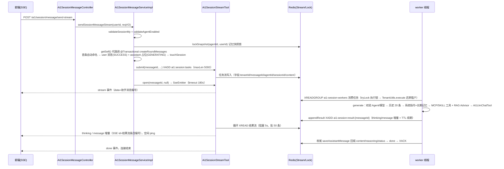

# AI1 会话与消息接口 (Ai1SessionController / Ai1SessionMessageController)

> 提供 AI1 场景下登录用户与 Agent（智能体）会话的生命周期管理：会话的创建/重命名/删除、消息的查询分页，以及核心的 **SSE 流式发送、断线续传、停止生成** 三个流式接口。消息生成采用「请求侧落库占位 + Redis Stream 任务队列 + worker 异步生成 + 结果流回放」的异步架构，SSE 连接与生成完全解耦，任意节点均可转发与续传。

## 接口路径前缀

- `/ai1/session` (Controller: Ai1SessionController，Tag「管理后台 - AI1 会话」)
- `/ai1/session/message` (Controller: Ai1SessionMessageController，Tag「管理后台 - AI1 会话消息」)

权限标识只有两个：用户侧读写统一 `ai1:session:my`，管理端查看统一 `ai1:session:query`（无独立 delete/update 权限按钮，`ai1:session:my` 已覆盖用户侧全部操作）。

---

## 1. 会话【我的】（Ai1SessionController，权限 ai1:session:my）

### 1.1 创建【我的】会话

- **路径**: POST /ai1/session/create-my
- **权限**: ai1:session:my
- **说明**: 在指定 Agent 下创建一条属于当前登录用户的会话，标题初始化为「新会话」，首条消息发送后自动替换为提问内容。

**请求参数 (Ai1SessionCreateMyReqVO)**:

| 字段 | 类型 | 必填 | 校验规则 | 说明 |
|-----|------|------|---------|------|
| agentId | Long | 是 | @NotNull("Agent 编号不能为空") | Agent 编号 |

**响应**: CommonResult\<Long\>（新会话编号）

**业务逻辑**: 1. `agentService.validateAgentEnabled(agentId)` 校验 Agent 存在且已开启，不存在抛 AGENT_NOT_EXISTS，已关闭抛 AGENT_DISABLE。2. 插入 `Ai1SessionDO`：绑定当前用户，title 固定为 `Ai1SessionDO.TITLE_DEFAULT`（"新会话"）。3. 返回会话编号；首条消息发出后由 `createRoundMessages` 自动命名（见 3.2）。

**错误码**:

| 错误码 | 说明 |
|-------|------|
| 1-041-007-000 | Agent 不存在 |
| 1-041-007-001 | Agent({}) 已关闭 |

### 1.2 修改【我的】会话标题

- **路径**: PUT /ai1/session/update-my
- **权限**: ai1:session:my
- **说明**: 修改当前用户自己的会话标题（手动重命名）。

**请求参数 (Ai1SessionUpdateMyReqVO)**:

| 字段 | 类型 | 必填 | 校验规则 | 说明 |
|-----|------|------|---------|------|
| id | Long | 是 | @NotNull | 会话编号 |
| title | String | 是 | @NotBlank、@Size(max = 50) | 新标题，最长 50 字符（与自动命名的 `TITLE_MAX_LENGTH` 上限一致） |

**响应**: CommonResult\<Boolean\>（true）

**业务逻辑**: 1. `validateSessionMy(userId, id)` 校验会话存在且归属当前用户，否则统一抛 SESSION_NOT_EXISTS（对「不存在」与「非本人会话」不区分，防越权探测）。2. `updateSessionTitle(id, title.trim())` 更新标题（去掉首尾空白）。

**错误码**:

| 错误码 | 说明 |
|-------|------|
| 1-041-008-000 | 会话不存在 |

### 1.3 删除【我的】会话

- **路径**: DELETE /ai1/session/delete-my
- **权限**: ai1:session:my
- **说明**: 删除当前用户自己的指定会话，**连带删除该会话全部消息**。

**请求参数**: Query 参数

| 字段 | 类型 | 必填 | 校验规则 | 说明 |
|-----|------|------|---------|------|
| id | Long | 是 | @RequestParam | 会话编号 |

**响应**: CommonResult\<Boolean\>（true）

**业务逻辑**: 1. `validateSessionMy` 校验归属（错误码同 1.2）。2. `@Transactional` 事务内：`sessionMapper.deleteById(id)` 删会话（逻辑删除），再 `sessionMessageService.deleteSessionMessageListBySessionIds` 按 `sessionId IN` 连带删除全部消息。Agent 删除时的级联清理走同构的 `deleteSessionListByAgentIds`（先查编号集合、空集合短路）。

**错误码**:

| 错误码 | 说明 |
|-------|------|
| 1-041-008-000 | 会话不存在 |

### 1.4 获得【我的】会话列表

- **路径**: GET /ai1/session/my-list
- **权限**: ai1:session:my
- **说明**: 获得当前用户在指定 Agent 下的全部会话，按创建时间倒序（编号倒序），**不做分页**，用于前端会话侧边栏。

**请求参数**: Query 参数

| 字段 | 类型 | 必填 | 校验规则 | 说明 |
|-----|------|------|---------|------|
| agentId | Long | 是 | @RequestParam | Agent 编号 |

**响应**: CommonResult\<List\<Ai1SessionRespVO\>\>（字段见 2.1，用户侧查询时 agentName / userNickname 为 null）

**业务逻辑**: 1. `sessionMapper.selectListByAgentIdAndUserId`：`eq agentId + eq userId`，`orderByDesc(id)`。2. `BeanUtils` 转 RespVO 直接返回，不回填 Agent 名称与用户昵称（该接口面向本人数据，前端无需展示归属）。

## 2. 会话管理（Ai1SessionController，权限 ai1:session:query）

### 2.1 获得会话分页

- **路径**: GET /ai1/session/page
- **权限**: ai1:session:query
- **说明**: 管理端分页查看全部用户的会话，可按 Agent / 标题 / 用户筛选，附带 Agent 名称与用户昵称。

**请求参数 (Ai1SessionPageReqVO，继承 PageParam)**:

| 字段 | 类型 | 必填 | 校验规则 | 说明 |
|-----|------|------|---------|------|
| agentId | Long | 否 | - | Agent 编号，为空时查询全部 Agent |
| title | String | 否 | - | 标题（模糊匹配） |
| userId | Long | 否 | - | 用户编号 |
| pageNo | Integer | 否 | PageParam | 页码 |
| pageSize | Integer | 否 | PageParam | 每页条数 |

**响应**: CommonResult\<PageResult\<Ai1SessionRespVO\>\>

| 字段 | 类型 | 说明 |
|------|------|------|
| id | Long | 会话编号 |
| agentId | Long | Agent 编号 |
| agentName | String | Agent 名称（批量回填） |
| userId | Long | 用户编号 |
| userNickname | String | 用户昵称（批量回填） |
| title | String | 会话标题（首条消息前为「新会话」） |
| createTime | LocalDateTime | 创建时间 |
| updateTime | LocalDateTime | 更新时间，即最近活跃时间（每轮消息发送/生成完成时 `touchSession` 刷新） |

**业务逻辑**: 1. `LambdaQueryWrapperX` 组装条件：`eqIfPresent(agentId)` + `likeIfPresent(title)` + `eqIfPresent(userId)`，`orderByDesc(id)`。2. `convertSet` 提取本页 agentId / userId 集合，分别经 `agentService.getAgentMap` 与 `adminUserApi.getUserMap` 批量查询。3. `MapUtils.findAndThen` 逐条回填 `agentName`、`userNickname`，Agent/用户已删除时字段保持 null 不报错。

## 3. 会话消息【我的】（Ai1SessionMessageController，权限 ai1:session:my）

### 3.1 获得【我的】会话消息列表

- **路径**: GET /ai1/session/message/my-list
- **权限**: ai1:session:my
- **说明**: 获得当前用户指定会话下的全部消息（按编号升序），**不做分页**，用于会话回放。

**请求参数**: Query 参数

| 字段 | 类型 | 必填 | 校验规则 | 说明 |
|-----|------|------|---------|------|
| sessionId | Long | 是 | @RequestParam | 会话编号 |

**响应**: CommonResult\<List\<Ai1SessionMessageRespVO\>\>（字段见 4.2）

**业务逻辑**: 1. Controller 先 `sessionService.validateSessionMy(getLoginUserId(), sessionId)` 防越权（非本人会话直接抛 SESSION_NOT_EXISTS）。2. `getSessionMessageListBySessionId`：`eq sessionId`，`orderByAsc(id)` 全量返回。

**错误码**:

| 错误码 | 说明 |
|-------|------|
| 1-041-008-000 | 会话不存在 |

### 3.2 发送消息（流式）

- **路径**: POST /ai1/session/message/send-stream（produces: text/event-stream）
- **权限**: ai1:session:my
- **说明**: 以 SSE 流式返回 AI 回复。请求侧只负责校验、落库与投递，生成由 worker 异步完成，SSE 转发线程从 Redis 结果流实时下发增量。

**请求参数 (Ai1SessionMessageSendReqVO)**:

| 字段 | 类型 | 必填 | 校验规则 | 说明 |
|-----|------|------|---------|------|
| sessionId | Long | 是 | @NotNull("会话编号不能为空") | 会话编号 |
| content | String | 是 | @NotBlank("请输入内容") | 提问内容 |

> 注意：本仓库为 JDK8 + Spring Boot 2.7.18（javax 校验体系），而该 VO 的 `@NotNull` / `@NotBlank` 引自 `jakarta.validation.constraints`（模块内 jakarta/javax 混用），在 javax Validator 下不会被校验，参数合法性依赖前端保证；详见 pitfalls.md。

**响应**: SseEmitter（**非** CommonResult 包裹；事件格式见第 5 节）

**业务逻辑**（`Ai1SessionMessageServiceImpl#sendSessionMessageStream`，全链路时序见第 6 节）:

1. **校验**: `validateSessionMy`（会话归属，SESSION_NOT_EXISTS）→ `agentService.validateAgentEnabled(session.getAgentId())`（AGENT_DISABLE）。
2. **落库**: `Ai1MemoryLockRedisDAO#lockSnapshot(agentId, userId, ...)` 持记忆快照锁（与长期记忆归档的「读新消息」互斥，保证水位线正确），锁内经 `getSelf()`（`SpringUtil.getBean` 取 AOP 代理，解决自调用事务失效）执行 `@Transactional` 的 `createRoundMessages`：
   - 首条消息判定为「title == 新会话 且 `selectCountBySessionId` == 0」双条件，以提问内容 trim 后作为标题，超过 `TITLE_MAX_LENGTH`（50）截断至 47 字符并拼接 `"..."`；
   - 插入 user 消息（content=提问内容，status=SUCCESS）与 assistant 占位（content=""，status=GENERATING），**assistant 占位编号即结果流标识**，前端刷新后可按它续传；
   - `touchSession` 刷新会话活跃时间（空实体 `updateById`，靠 MyBatis-Plus update fill 填充 update_time），返回助手消息编号。
3. **投递**: `Ai1SessionStreamTool#submit` 把任务字段（tenantId 可选 / messageId / agentId / sessionId / content）XADD 到任务流 `ai1:session:tasks`，`maxLen(5000).trimNonStrict()` 近似裁剪；投递异常时 `failSubmittedMessage` 补偿——按「id + role=assistant + status=GENERATING」条件回填 FAILED（Redis 超时不代表任务一定未写入，避免覆盖 worker 已回填的终态），随后异常上抛。
4. **建连**: `sessionStreamTool.open(messageId, null)` 创建 SseEmitter（超时 `yudao.ai1.session.stream.timeout-ms` 默认 180s），提交 `sseExecutor`（SynchronousQueue 有界线程池，`maxConnections` 默认 64，满时 AbortPolicy 直接返回「服务繁忙，请稍后重试」error）。转发线程先下发 `stream` 事件（data 为助手消息编号），随后循环 XREAD 结果流 `ai1:session:result:{messageId}`（阻塞 5s、批 50 条）实时转发 `thinking` / `message` 增量（SSE 事件 id = 结果流条目编号，供续传），空闲发 `ping` 心跳，收到 `done` / `error` 终态结束；临近连接超时且结果流不存在时判定任务丢失，回写 FAILED 并下发 error（"生成任务已丢失，请重新发送"）。
5. **失败兜底**: 校验/落库/投递失败**不抛异常**，捕获 ServiceException 后返回只含 `error` 事件的 SSE（消息为错误码文案；其他异常为 "会话提交失败，请稍后重试"），前端按普通 SSE 错误分支渲染。

**错误码**（以 error 事件下发，非 CommonResult 包裹；data 为 JSON 字符串，编码约定见第 5 节）:

| 错误码 | 说明 |
|-------|------|
| 1-041-008-000 | 会话不存在 |
| 1-041-007-001 | Agent({}) 已关闭 |
| 1-041-007-000 | Agent 不存在（`validateAgentEnabled` 校验；worker 生成阶段 `validateAgentExists` 亦会抛出） |

### 3.3 断线续传（流式）

- **路径**: POST /ai1/session/message/resume-stream（produces: text/event-stream）
- **权限**: ai1:session:my
- **说明**: 断线 / 刷新页面后，按助手消息编号 + 已收到的最后事件编号，从 Redis 结果流断点继续转发，**不重新生成**。

**请求参数**: Query 参数

| 字段 | 类型 | 必填 | 校验规则 | 说明 |
|-----|------|------|---------|------|
| messageId | Long | 是 | @RequestParam | 助手消息编号（即结果流标识，`GENERATING` 占位的 id） |
| lastEventId | String | 否 | @RequestParam(required = false) | 已收到的最后一个事件编号（格式 `毫秒时间戳-序号`），为空或非法时从头重放 |

**响应**: SseEmitter（事件格式同 3.2）

**业务逻辑**: 1. `selectById` 校验消息存在且 `Ai1SessionMessageRoleEnum.isAssistant`（非助手消息拒绝，否则抛 SESSION_MESSAGE_NOT_EXISTS），再 `validateSessionMy(message.getSessionId())` 校验所属会话归属当前用户。2. `sessionStreamTool.open(messageId, lastEventId)`：`parseStreamMessageId` 解析 `毫秒时间戳-序号` 格式，转发线程从该位置之后 XREAD 结果流重放。由于生成与连接解耦（worker 只写结果流，SSE 只读转发），刷新后可在**任意节点**续传，任务丢失判定与「服务繁忙」兜底同发送链路。

**错误码**:

| 错误码 | 说明 |
|-------|------|
| 1-041-009-000 | 会话消息不存在（消息不存在或非 assistant 角色） |
| 1-041-008-000 | 会话不存在（所属会话非本人） |

### 3.4 停止【我的】会话生成

- **路径**: POST /ai1/session/message/stop-my
- **权限**: ai1:session:my
- **说明**: 终止会话中生成中的助手消息，保留已生成的内容（正文追加「本条回复已被人工终止」提示，状态置 FAILED，只写 done 事件）。

**请求参数**: Query 参数

| 字段 | 类型 | 必填 | 校验规则 | 说明 |
|-----|------|------|---------|------|
| sessionId | Long | 是 | @RequestParam | 会话编号 |

**响应**: CommonResult\<Boolean\>（true）

**业务逻辑**（跨节点生效）: 1. `validateSessionMy` 校验会话归属。2. `sessionStreamTool.cancel(sessionId)`：a) `getGeneratingAssistantMessageIdList` 只查 id，定位请求时刻 GENERATING 的助手消息（之后的新一轮不受影响）；b) 每条消息 `SET ai1:session:stop:{messageId}` 停止意图（TTL 与结果流一致）+ `PUBLISH ai1:session:stop` Topic 广播通知；c) `cancelQueuedTask` 尝试抢执行锁 `ai1:session:task-lock:{messageId}`，抢到说明任务仍在排队无 worker 在生成，直接保留部分结果 + TERMINATED_NOTICE 置 FAILED 并补写 done。3. 执行节点经 RTopic 订阅回调（`stopChecker.execute` 避免阻塞 Redisson 订阅线程）与 1s 定时 `checkStopRequests` 兜底感知停止意图，`RunContext#cancel` 中断生成线程，并由独立 reaper 线程回收该轮已启动的 Shell 进程（单个进程最多等 5s）。

**错误码**:

| 错误码 | 说明 |
|-------|------|
| 1-041-008-000 | 会话不存在 |

## 4. 会话消息管理（Ai1SessionMessageController，权限 ai1:session:query）

### 4.1 获得会话消息分页

- **路径**: GET /ai1/session/message/page
- **权限**: ai1:session:query
- **说明**: 管理端分页查看指定会话的消息，按消息编号倒序取最新页，**页内反转为时间正序**返回。

**请求参数 (Ai1SessionMessagePageReqVO，继承 PageParam)**:

| 字段 | 类型 | 必填 | 校验规则 | 说明 |
|-----|------|------|---------|------|
| sessionId | Long | 是 | @NotNull（javax.validation.constraints） | 会话编号 |
| pageNo | Integer | 否 | PageParam | 页码 |
| pageSize | Integer | 否 | PageParam | 每页条数 |

**响应**: CommonResult\<PageResult\<Ai1SessionMessageRespVO\>\>（字段见 4.2）

**业务逻辑**: 1. Mapper `selectPage`：`eq sessionId`，`orderByDesc(id)` 取最新一页。2. ServiceImpl 中 `Collections.reverse` 把最新页反转为时间正序返回，前端无需再排序。

### 4.2 获得会话消息列表

- **路径**: GET /ai1/session/message/list
- **权限**: ai1:session:query
- **说明**: 管理端查看**任意用户**会话的全部消息明细（按编号升序全量返回）。与 3.1 的唯一区别是不做归属校验。

**请求参数**: Query 参数

| 字段 | 类型 | 必填 | 校验规则 | 说明 |
|-----|------|------|---------|------|
| sessionId | Long | 是 | @RequestParam | 会话编号 |

**响应**: CommonResult\<List\<Ai1SessionMessageRespVO\>\>

| 字段 | 类型 | 说明 |
|------|------|------|
| id | Long | 消息编号；**助手消息的编号同时作为断线续传的结果流标识** |
| sessionId | Long | 会话编号 |
| role | String | 消息角色：user / assistant（枚举 `Ai1SessionMessageRoleEnum`） |
| reasoning | String | 思考过程，即推理模型的 reasoning_content（仅 assistant 且模型支持推理时有值） |
| content | String | 内容；GENERATING 占位阶段为 ""，人工终止/失败时保留部分内容并追加提示 |
| status | Integer | 生成状态（枚举 `Ai1SessionMessageStatusEnum`）：0=生成中、1=完成、2=失败 |
| createTime | LocalDateTime | 创建时间 |

**业务逻辑**: 1. 直通 `getSessionMessageListBySessionId(sessionId)`（`orderByAsc(id)`），无归属校验，管理端可跨用户查看。

## 5. SSE 事件协议（Ai1SessionStreamEventEnum）

send-stream / resume-stream 两个接口共用同一套事件（`Ai1SessionStreamTool` 转发），`@Operation` description 声明如下：

| 事件 | 名称 | data 内容 | 说明 |
|------|------|----------|------|
| stream | 结果流标识 | 助手消息编号（JSON 字符串） | 连接建立时首先下发，前端以此锚定续传的 messageId |
| thinking | 思考过程增量 | 增量文本（JSON 字符串） | 推理模型的 reasoning_content 逐段下发 |
| message | 回复内容增量 | 增量文本（JSON 字符串） | 正文逐段下发 |
| ping | 空闲心跳 | - | 结果流无新事件时保活 |
| done | 生成结束 | - | 终态事件，连接正常结束 |
| error | 生成失败 | 错误提示（JSON 字符串） | 终态事件，连接异常结束 |

**关键约定**:

1. **事件 data 统一为 JSON 字符串**（如 `"四光年"`），前端需 `JSON.parse` 后展示——否则换行与首字符空格会被 SSE 协议截断（源码类注释【关键约定】明确）。
2. **SSE 事件 id = 结果流条目编号**（`毫秒时间戳-序号`），前端保存最后一个 id 作为 `lastEventId` 用于续传。
3. `done` / `error` 为终态（`isTerminal` 判定），驱动连接结束；人工终止只写 done、停机/中断写 error。
4. 辅助提示语（本条回复已被人工终止 / 本条回复生成失败 / 生成任务已中断，请重新发送等）不是独立事件，而是以 `"\n\n> "` 前缀（`NOTICE_PREFIX`）追加进正文并持久化到 DB（前端刷新后重新拉取消息列表时可见），不作为独立 SSE 事件实时下发；INTERRUPTED_MESSAGE / FAILED_NOTICE 在补偿与失败路径会作为 error 事件的 data 下发（executeTask 5.1/5.2、completeTaskResult）；LOST_MESSAGE 仅作为 error 事件 data 下发、不进入正文。

## 6. 消息发送全链路

容错链路（对应源码类注释的多层兜底）：

| 场景 | 兜底机制 |
|------|---------|
| 任务投递失败 | `failSubmittedMessage` 仅把仍 GENERATING 的占位置 FAILED |
| SSE 连接断开/刷新 | 前端按 stream 事件的 messageId + lastEventId 调 resume-stream 重放结果流，不重新生成 |
| worker 执行中实例宕机 | `consumeLoop` 每 60s `reclaimTasks` 认领 PEL 中空闲超过（SSE 超时+60s）的任务，接管后按「结果流已存在 → 中断收尾」处理，不重跑 |
| 转发连接临近超时且结果流不存在 | `failLostMessage` 判定任务丢失，回写 FAILED 并下发 error（"生成任务已丢失，请重新发送"） |
| 孤儿生成（无结果流、无 worker） | 记忆归档前置 `failStaleMessage` 按超时收尾，避免永久阻塞归档水位线 |
| 人工停止 | 停止意图 + Topic 广播跨节点中断，保留部分内容 + TERMINATED_NOTICE |

## 附：本域错误码汇总（Ai1ErrorCodeConstants，1-041 段）

| 错误码 | 说明 | 触发点 |
|-------|------|--------|
| 1_041_008_000 | 会话不存在 | `validateSessionMy` 对「会话不存在或非本人」统一抛出（防越权，不泄露他人会话存在性），覆盖 6 个「我的」端点：update-my、delete-my、消息 my-list（Controller 先校验）、send-stream、resume-stream、stop-my |
| 1_041_009_000 | 会话消息不存在 | resume-stream 校验消息不存在或非 assistant 角色时抛出 |
| 1_041_007_000（关联） | Agent 不存在 | create-my / send-stream 校验、worker generate 第 1 步 |
| 1_041_007_001（关联） | Agent({}) 已关闭 | create-my / send-stream 的 `validateAgentEnabled` |
| 1_041_001_005（关联） | 所选模型不是对话模型 | worker 生成阶段 `modelService.getModelRespBO` 校验抛出；该异常在 executeTask 5.2 统一收尾，客户端 error 事件收到的是通用提示「本条回复生成失败」（FAILED_NOTICE），具体错误信息仅记日志不下发 |

非错误码的流式提示常量（`Ai1SessionStreamTool`，随 error/done 事件或正文提示下发）：`LOST_MESSAGE`「生成任务已丢失，请重新发送」、`INTERRUPTED_MESSAGE`「生成任务已中断，请重新发送」、`TERMINATED_NOTICE`「本条回复已被人工终止」、`FAILED_NOTICE`「本条回复生成失败」、`TRANSPORT_ERROR_MESSAGE`「会话连接异常，请刷新后重试」。Service 层（`Ai1SessionMessageServiceImpl`）另有「会话提交失败，请稍后重试」「会话续传失败，请稍后重试」；`Ai1SessionStreamTool` 层（`open` 的 `RejectedExecutionException` 分支）另有「服务繁忙，请稍后重试」。

模块错误码段号说明：ai1 模块统一使用 1-041-000-000 段，本域占用会话 1-041-008-xxx、会话消息 1-041-009-xxx 两小段。

## 相关文档

- [api-agent.md](api-agent.md) — Agent 管理（会话创建/发送时校验的 `agentId` 上游）
- [api-home.md](api-home.md) — 首页统计（消息趋势/排行直接聚合 `ai1_session_message`）
- [data-model.md](data-model.md) — `ai1_session` / `ai1_session_message` 表结构与 ER 关系
